<p align="center"></p>
<p align="center"><sub><i>Personal project by a participant; not affiliated with or endorsed by Susquehanna.</i></sub></p>

## My journey

*Day one by hand (−10.3k); the engine took over that afternoon and ran 24/7 on a server from Oct 7.*

### Final Results for upbeat-cedar-5206

<div align="center">
<table>
<tr>
<td align="center"><sub>Final rank</sub><br><b>#67</b> <sub>of 1,969 · top 3.4%</sub></td>
<td align="center"><sub>P&amp;L</sub><br><b>+73.3k</b> <sub>+73%</sub></td>
<td align="center"><sub>Best rank</sub><br><b>#62</b></td>
<td align="center"><sub>Trades</sub><br><b>20,544</b></td>
<td align="center"><sub>Volume</sub><br><b>3.6M</b></td>
</tr>
</table>
<sub>SIG settlement in progress (board as of 04:58 PT, Nov 5) · 179.7k if every market settles on its result.</sub>
</div>

<table>
<tr>
<td width="25%" align="center"><a href="https://pieropls.github.io/PredictionsCup26/journey.html#account">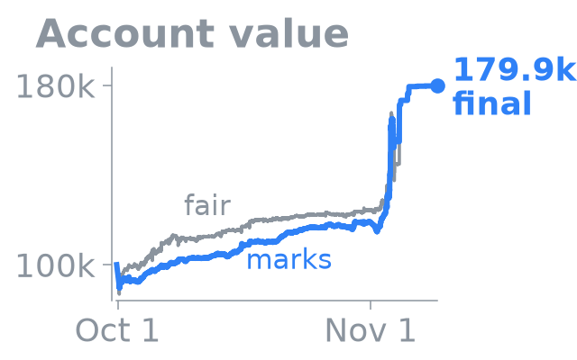</a><br><sub>Account from 100k</sub></td>
<td width="25%" align="center"><a href="https://pieropls.github.io/PredictionsCup26/journey.html#rank">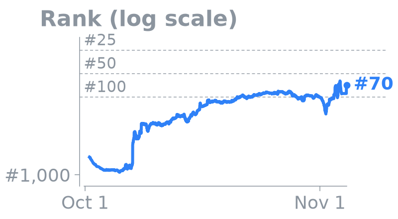</a><br><sub>Rank over time</sub></td>
<td width="25%" align="center"><a href="https://pieropls.github.io/PredictionsCup26/journey.html#daily">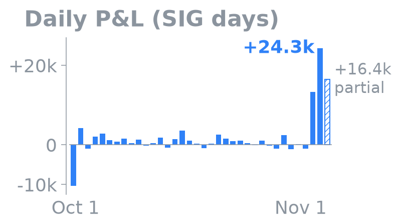</a><br><sub>Daily P&L</sub></td>
<td width="25%" align="center"><a href="https://pieropls.github.io/PredictionsCup26/journey.html#ranking">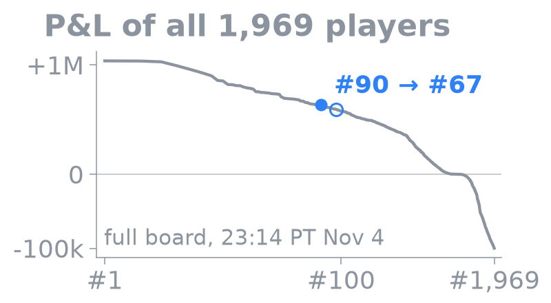</a><br><sub>All players · #90 → #67</sub></td>
</tr>
</table>
<p align="center"><sub>Click a chart to explore it: hover, zoom, full size.</sub></p>

<details><summary><b>Full-size charts and the final portfolio</b></summary>

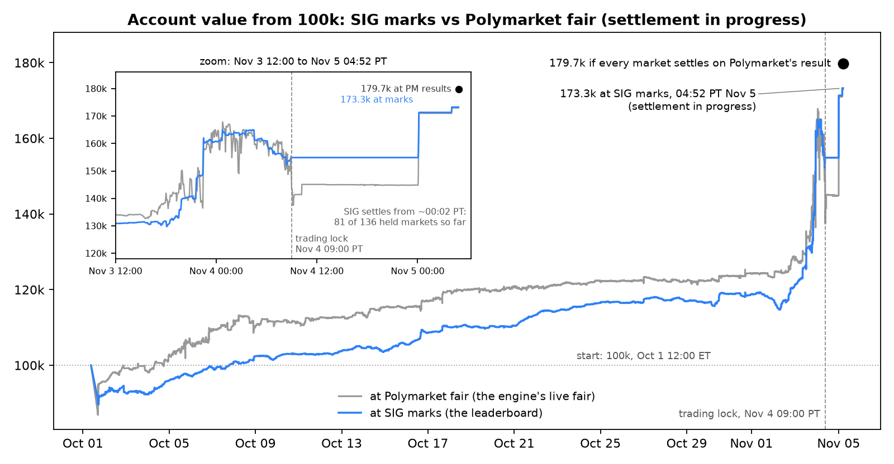
*The account from 100k at SIG's marks and at Polymarket fair; the dot is the value if every market settles on Polymarket's result.*

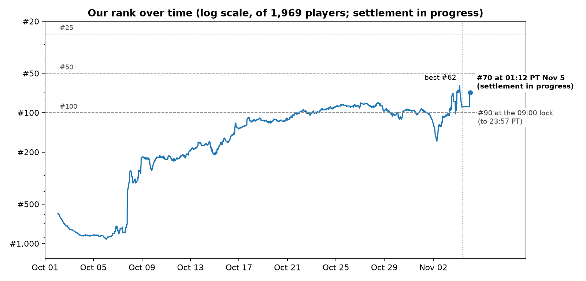
*From around #900 in week one to the top 100 by Oct 21; best #62 on election night.*

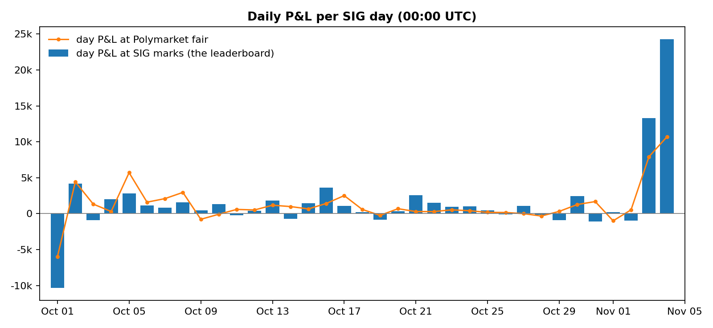
*P&L per SIG day (00:00 UTC) at SIG's marks, with the day at Polymarket fair as a line.*

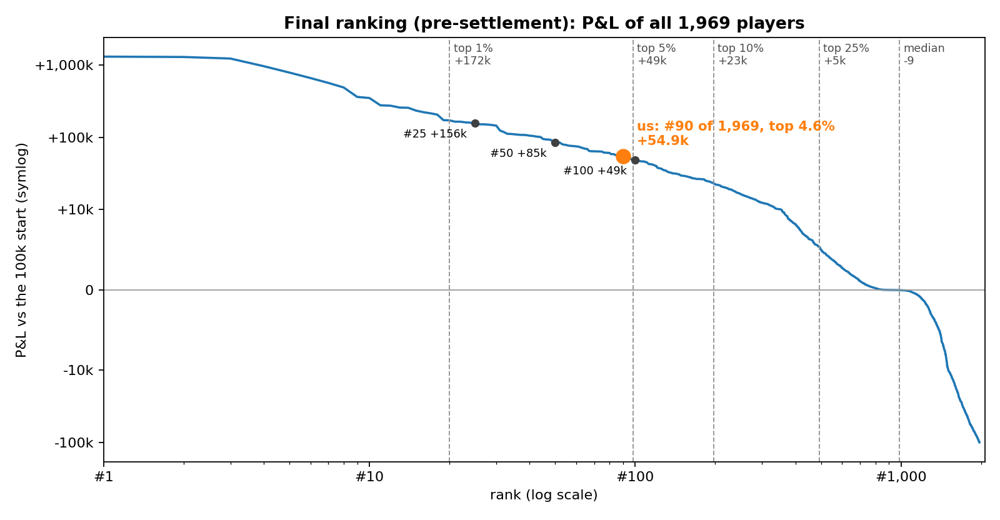
*Every player's P&L on the last full board (23:14 PT Nov 4, before settlement): hollow, us at #90 then; filled, #67 on the latest board.*

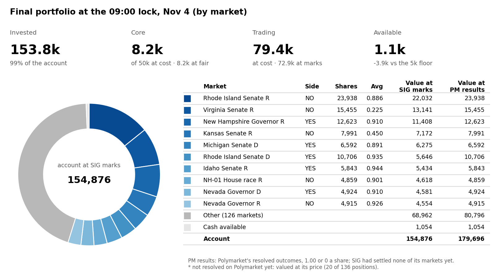
*136 positions at the 09:00 lock, before settlement: the top ten are worth 84.9k at SIG marks and 97.8k at Polymarket's results.*

</details>

## Piero's Intel

The system I built and ran for 34 days: one Python engine on one server, watched from my laptop, by Claude and by me.

**[Open the dashboard →](https://pieropls.github.io/PredictionsCup26/)** <sub>frozen after the close, before settlement</sub>

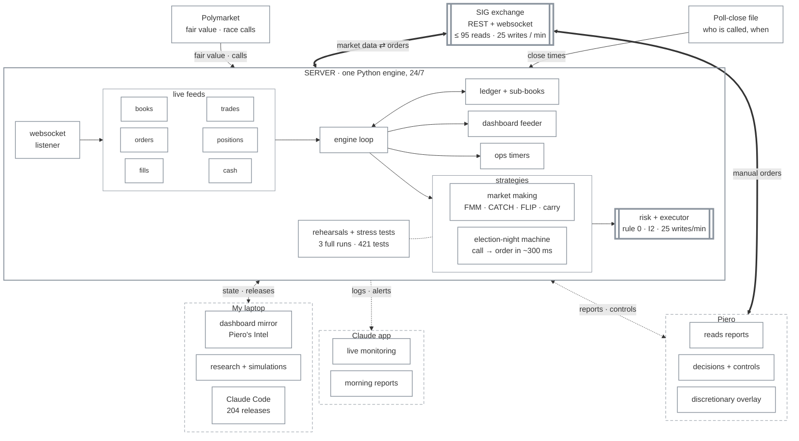

**204 releases in 34 days · 421 tests · 3 full rehearsals · ~300 ms from race call to order**

<details><summary><b>What each box does</b></summary>

#### Data

| Box | What it does |
|---|---|
| **SIG exchange** | One YES book per contract (NO = 1 − YES); 237 contracts across 117 races (116 armed on election night). REST for orders, cancels and positions: ≤ 95 reads and 25 writes a minute. Websocket for books, trades and fills. The board shows SIG marks; the score is cash after every market resolves. |
| **Polymarket** | The deeper market on the same races; its mid is the fair value for every SIG contract. A race counts as called when the side bid holds ≥ 0.95 for 20 s, or prints ≥ 0.98 once, after the last poll close. |
| **Poll-close file** | Every race, its state, and when its last polls close. No call is trusted before that time; resting orders are pulled 10 minutes before each first close. |

#### Server

| Box | What it does |
|---|---|
| **Websocket listener** | Holds the live connection to SIG and turns each message into a state update; Polymarket is polled alongside. |
| **Live feeds** | Books, trades, orders, positions, fills, cash, all in memory. Every strategy reads the same snapshot, and all reads share one budget of ≤ 95 a minute. |
| **Engine loop** | Refreshes state; each layer proposes orders; the executor checks them and sends them. Runs under systemd on the server, 24/7, from Oct 7 to Nov 4 (on my laptop before that). |
| **Ledger + sub-books** | Every share belongs to exactly one layer, and a layer can only sell its own lots. The sub-books always sum to the real SIG position; I2 (reducing orders never exceed the position) is property-tested over 500 seeds. |
| **Market making** | FMM quotes favourites under fair: 3,912 round trips, +5.5k realized.<br>CATCH v1 → v3 posts deep bids that catch sweeps and sells them on the snap-back: +7.9k realized.<br>FLIP takes first in queue and flips on the fill: 442 flips, +0.9k.<br>Carry and two-book locks hold to settlement. |
| **Election-night machine** | A call detector after each state closes.<br>A sniper under min(0.97, PM − 3c), up to 15k shares a race.<br>A reversal guard: if PM drops under 0.90 within 10 min, that race stops.<br>Recycling at ≥ 0.97 (from 16:14) to fund the next wave.<br>The result: calls on 229 books in 115 of 116 races; 296k shares at an average of 0.940, +9.8k vs fair; 297 ms p50 from call to order hand-off. |
| **Rehearsals + stress tests** | 3 full rehearsals with synthetic calls injected into the live feed; a night simulator at different cash levels; 421 tests. |
| **Risk + executor** | Rule 0 (never sell below the lot average + 0.5c); I2 and the cash floor checked before every order; 25 writes a minute, 5 of them reserved for the call lane; a kill switch per layer. |
| **Ops timers** | systemd timers for every scheduled step (the 14:40 go-live, poll-close pulls, wind-downs), plus health checks, alerts, the run log and a settlement watch. |
| **Dashboard feeder** | Publishes the account at SIG marks and at fair, the rank, cash and the night's calls. |

#### My laptop

| Box | What it does |
|---|---|
| **Dashboard mirror** | Piero's Intel: the live account, rank, cash and calls by wave. |
| **Research + simulations** | Tape studies, the night simulator, parameter sweeps before each change. |
| **Claude Code** | Writes, tests and deploys the engine: 204 releases in 34 days. |

#### Claude app

| Box | What it does |
|---|---|
| **Live monitoring** | Reads the live state and logs, flags faults and drift, checks every release. |
| **Morning reports** | P&L, rank vs #50 / #100, what changed overnight, what to decide. Decisions become written specs for Claude Code. |

#### Piero

| Box | What it does |
|---|---|
| **Reads reports** | Turns morning and live reports into the day's changes. |
| **Decisions + controls** | Turns layers on and off, sets caps and timings, stops and re-arms the election machine. |
| **Discretionary overlay** | Manual trades where the engine can't act (crashes, thin books, prices far below a resolved value). They're booked in a separate manual sub-book that the engine never trades. |

</details>

## Strategies deployed

Seven layers on one ledger: five ran around the clock, one was built for election night, and my own hand sat on top.

<details><summary><b>01 · The Favourite Maker</b> · FMM · <i>quotes favourites under fair</i> · <b>+5.5k</b> · 3,912 round trips</summary>

Bids on favourites (Polymarket fair ≥ 0.75) at the touch and 1–3c under it, never above fair − 2c; each filled lot is offered straight back to recycle the cash.
- **Parameters:** 5k a race at cost; exits at max(fill + 0.5c, fair + the book's 6-hour median gap).
- **Ran:** Oct 17 → Nov 1; relaunched Nov 2 18:26 → Nov 3 00:47.
- **Result:** +5.5k realized over 3,912 round trips (18,400 fills).

</details>

<details><summary><b>02 · The Net</b> · CATCH v1 → v3 · <i>catches sweeps and fat fingers</i> · <b>+7.9k</b> in ~25 h</summary>

Deep bids under SIG's book and Polymarket fair, filled when someone sweeps the book and sold back on the snap-back.
- **Parameters (v3):** levels at min(SIG bid − 4/8/15c, fair − 10/15/25c) and fair − 40c; exits at max(fill + 3c, min(pre-sweep mid, fair − 1c)).
- **Ran:** the first dump / fat-finger layers Oct 4 → 16; v1 → v3 Nov 2 → Nov 3 12:30.
- **Result:** +7.9k realized in about 25 hours (57 exits). One NH Governor R sweep filled 22,306 shares at +6.1k vs fair.

</details>

<details><summary><b>03 · The Flipper</b> · FLIP · <i>first in the queue, flips on the fill</i> · <b>+0.9k</b> · 442 flips</summary>

On books with a SIG spread ≥ 2c, one bid first in the queue at the best bid + 0.5c; on a fill, an ask goes up at once at max(fill + 1c, best ask − 0.5c).
- **Parameters:** the 60 widest books, 1k a book, bid ≤ fair − 3c.
- **Ran:** Nov 2 18:32 → Nov 3 08:00.
- **Result:** +0.9k realized. The 442 flips are exit fills (150k shares) on 247 entry fills, from the engine's FLIP counter on Nov 3, before the ledger's 4,000-fill window dropped the early ones. Median about 40 minutes from fill to flip.

</details>

<details><summary><b>04 · The Long Hold</b> · carry + convergence · <i>holds favourites to settlement</i> · <b>EV +13%</b> per dollar at the first close</summary>

Favourites held to settlement as a carry book: bids at EV/$ ≥ 11%, sales at EV/$ ≤ 5%, never below the lot average + 0.5c. From Oct 29 the convergence sales funded the election reserve.
- **Ran:** Oct 17 → Nov 4.
- **Result:** at the first poll close, 20 lots, 8.3k at cost, EV +1.1k (+13% per dollar). The peak was 33 lots, 25.4k at cost.

</details>

<details><summary><b>05 · The Lock</b> · pair sets, H4, two-book locks · <i>both sides for under 1</i> · <b>+1.4k</b> locked at entry · +0.2k held to settlement</summary>

Both sides of a two-candidate race bought for under 1 in total. Pair sets were mostly unwound early, the majority above cost; H4 and the two-book locks held to settlement.
- **Parameters:** H4 ≤ 0.96 a set; the market maker's locks ≤ 0.99.
- **Ran:** pair sets Oct 1–4, H4 from Oct 11, two-book locks Oct 17 → Oct 29.
- **Result:** the 141 pair sets locked +1.4k at entry; most were unwound early, the majority above cost. The two-book locks held to settlement: +0.2k on 11.7k shares. H4 itself never found a set.

</details>

<details><summary><b>06 · The Sniper</b> · election-night machine · <i>buys races as they're called</i> · <b>+9.8k</b> vs fair · 296k shares</summary>

- **Call detector:** a Polymarket side bid ≥ 0.95 for 20 s or ≥ 0.98 once, after the state's last poll close. **229 books in 115 of 116 races.**
- **Sniper:** walks SIG's book up to min(0.97, PM bid − 3c), ≤ 15k shares a race, on its own thread. **636 fills, 296k shares at 0.940, +9.8k vs fair.**
- **Reversal guard:** a PM bid back under 0.90 within 10 minutes stops the race. **Fired 34 times on 21 races.**
- **Recycling:** sells called winners to fund later waves. **31,079 shares at 0.979, +1.0k vs cost.**
- **Poll-close pulls:** entry layers pull 600 s before the first close; **419–422 s measured** in the rehearsals.
- **Final sweep, 01:03 → 08:30:** bought resolved winners still offered on SIG. **11,585 shares at 0.929, +0.8k.**

**The night, Nov 3 PT**
- **14:40** Election mode live: 234 books in 116 races armed.
- **16:00** First calls; the sizing formula caps snipes at ~1.7k shares a race.
- **16:14** C135 raises the wave multiplier from 2.5 to 8.
- **17:00 / 18:00** The two big waves, ~103k shares each.
- **19:15** C138: sellers stop selling called winners.
- **22:04** Alaska Senate (ranked choice) is called; at 22:29 the cash from a 20.5k sale is spent in 7 seconds.
- **01:03** Election lane stopped; final sweep until 08:30.

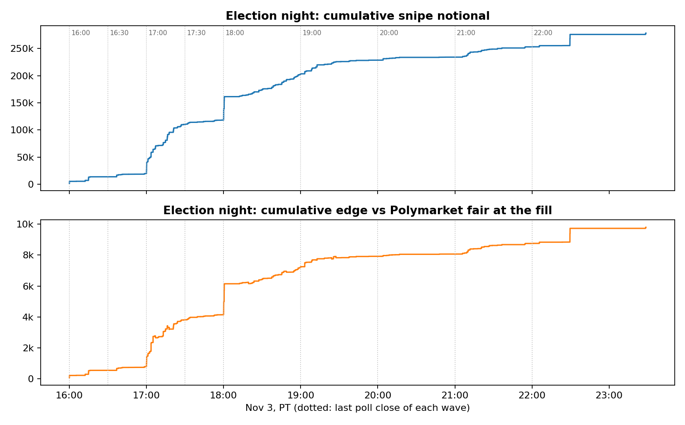

**Calls on 229 books in 115 of 116 races · 296k shares at 0.940 · +9.8k vs fair · 297 ms p50 from call to order hand-off (p95 608 ms).**

</details>

<details><summary><b>07 · The Human Overlay</b> · discretionary trades · <i>where the engine can't act</i> · manual</summary>

Manual trades where the engine can't act: crashes, thin books, prices far below a resolved value. They're booked in a separate manual sub-book that the engine never trades.

</details>

## Takeaways

1. **Size a reserve by its opportunity cost.** The election reserve left the catchers idle for a week while the tape showed 1.56M of sweep edge vs fair (at full sweep size); they caught about 0.6k.
2. **Optimise for the scoring rule, not the marks.** At the lock the board said 154.9k while settlement value was 179.7k, and the rank went from #62 to #90 on SIG's lagging marks; settlement had brought it back to #67 by 04:13 PT Nov 5.
3. **Size from the book, not one formula.** The first wave bought 1,803 Virginia Senate R NO with 388k shares on the book under the cap.
4. **Every seller must read the call state.** The release layer sold 69,084 shares of called winners at 0.9527 while the sniper bought the same books at up to 0.97.
5. **Keep one exclusion list for every layer.** The sniper bought 14,949 Alaska Senate R NO in a ranked-choice race; the forced exit cost about 1.8k.
6. **Keep one cash authority.** The cash from a 20.5k sale was spent in 7 seconds on queued snipes; SIG then refused writes while the engine still read 20.5k of cash.

<details>
<summary><b>Full post-mortem</b></summary>

**1. An election cash reserve starved the dump catchers for a week**
- **Symptom:** the dump, fat-finger, ladder and wall layers all showed `full` and rested nothing. From Oct 26 to Nov 2 the tape showed 126 sweeps worth 1.92M of edge vs fair, 1.56M of it after the reserve started. About 0.6k was caught, and the rank slid from about #90 to #120 (low #164 on Nov 2).
- **Cause:** from Oct 28, a reserve ramping from 20k to 60k was held back for election night, so every entry layer saw free cash under 2k. The catchers had in fact been dry since Oct 17, when the market maker took first claim on free cash. Nothing alerted on a layer marked `full` that rested 0 orders.
- **Fix:** CATCH v2/v3 on Nov 2 was exempted from the reserve and anchored on SIG's book as well as Polymarket. It made +7.9k in about 25 hours.
- **Next time:** size a reserve with its opportunity cost, not only its funding cost (the study counted only the sales needed to raise it). Alert when a layer that's switched on has rested nothing for an hour.

**2. Board marks vs settlement value**
- **Symptom:** after the calls the board fell from 165.0k to 154.9k at the lock while the settlement value held at about 179.7k. The rank went from #62 to #90 overnight.
  - Resolved winners sat at thin SIG prices: 15,455 Virginia Senate R NO had a 0.695 bid (10.7k) against 15.5k at settlement.
  - The engine's own fair fell back to SIG's mid wherever Polymarket stopped quoting resolved markets.
- **Cause:** SIG values positions at a lagging `currentPrice` that drives the leaderboard. It isn't the last trade (it matched on 5 of 113 positions). The rank chase used board ranks.
- **Fix:** reporting only. The hourly lines valued called sides at 1.00, and the final snapshots showed both values. The final sweep bought resolved winners at 0.89–0.95.
- **Next time:** pin down the scoring rule in week one (settled outcome vs SIG's VWAP close-out), and run the rank chase on settlement value, not marks.

**3. Per-race sizing too small at the first wave, fixed live**
- **Symptom:** at 16:00, Virginia Senate R NO bought 1,803 shares with 388k shares on the book under the cap. Georgia and Kentucky were the same.
- **Cause:** wave share = multiplier × usable cash ÷ uncalled races in this and later waves. With a multiplier of 2.5 that gave about 1.7k a race. The sims had picked a low multiplier to protect a reversal night and the last wave. The rehearsals logged the same small shares, but no pass/fail criterion looked at them.
- **Fix:** C135, live at 16:14, raised the multiplier to 8 (about 4.6k a race) and topped up the open races.
- **Next time:** add a rehearsal criterion for depth left on the table. Size the first wave from what the book offers, then hold back for later waves, rather than one formula for all.

**4. Sellers recycled winners below the sniper's own price**
- **Symptom:** from 16:00 to 18:12 the generic release layer sold 69,084 shares of freshly called winners at 0.9527, while the sniper was buying the same books at up to 0.97.
  - A new fast recycler went live at 17:15 with asks under the sniper's cap. It was killed after 3 minutes.
  - 19 rule-0 alarms came from sales of snipe lots.
- **Cause:** the older sellers knew nothing about called races ("sell lots with < 3% left at the touch", and the no-edge asks). There was no self-cross check between the sniper and the engine's own asks. The rehearsals never reached the sale branch.
- **Fix:** C138, built and replayed against the night's 260 call events mid-night, live 19:15:
  - the release layer never sells a called side;
  - the recycler asks ≥ max(lot + 2c, 0.97) and above the book's call cap.
- **Next time:** every seller reads the call state, and the night design covers every layer, not only the new ones.

**5. The Alaska ranked-choice exclusion was missing from the sniper**
- **Symptom:** the detector called Alaska Senate at a Polymarket bid of 0.95 at 22:04. The sniper bought 14,949 R NO at 0.926.
- **Cause:**
  - Alaska counts by ranked choice for about two weeks, so it can't settle by Nov 4. That adds SIG's VWAP close-out risk to the race risk.
  - CATCH had Alaska, Maine and Georgia on its skip list; the sniper had its own, shorter list.
  - The rehearsals scripted Alaska as "no call", so the case was never exercised.
- **Fix:** none in code. The election lane was stopped at 01:03 and the shares were sold at 0.80–0.83 (about −1.8k). The call direction still looks right; the loss came from the forced exit.
- **Next time:** one exclusion list read by every layer, and a rehearsal in which a ranked-choice race gets called.

**6. Cash accounting in bursts**
- **Symptom:**
  - In the Oct 21 sim, a filled snipe was counted twice: in the commit ledger and in the falling raw cash. A lost executor answer also released its budget twice, so the first two waves took everything.
  - On the night the error ran the other way. At 22:29 the sniper spent the cash from a 20.5k sale in 7 seconds on queued snipes. SIG refused writes with "insufficient available funds" while the engine read 20.5k of cash.
  - At 18:00 SIG also turned out to reserve funds for resting orders, which an Oct 2 test had ruled out.
- **Cause:** probably that the sim fix released the fill hold at once while the cash read lagged behind it, plus two cash models, the engine's and SIG's.
- **Fix:** C103/C104 fixed the double count before the night. The live over-spend ended when the lane stopped at 01:03.
- **Next time:** treat SIG's available funds as the only cash authority, use an order record that counts only what was sent and filled, and put every order through the same check.

</details>

## Code

```
data/        pm_map.json + derived results (pnl_daily, rank, night_snipes, releases, portfolio_final)
server/      systemd unit, start script, ops timers, deploy and rollback
research/    night/ (simulator, rehearsals) · tests/ (421 tests, fake SIG, night rig) · tape/ (k_tape_study.py)
dashboard/   g_dashboard, h_status, m_dash4, q_dash5, r_dash5_ui + site/ (frozen Piero's Intel, journey.html)
engine/      a_config → n_election, the pipeline in reading order, + requirements.txt, .env.example
img/         README images only
```

<details><summary><b>How to run</b></summary>

```bash
python3 -m venv .venv && .venv/bin/pip install -r engine/requirements.txt
# 421 tests, about a minute, no network
python3 -m unittest discover research/tests
# the I2 property test over 500 seeds (run before every release)
I2_SEEDS=500 python3 -m unittest research/tests/test_executor.py
# SIG_API_KEY, SIG_ENGINE_HOST, SIG_DATA, ...
cp engine/.env.example .env
# dry run: reads everything, sends nothing
SIG_DATA=/tmp/sig-dry python3 -u engine/f_engine.py
# live: trades, and refuses on any host but SIG_ENGINE_HOST
python3 -u engine/f_engine.py --live
```

- **engine/** is the pipeline in reading order: `a_config` (settings) → `b_sig` (SIG client) → `c_polymarket` → `d_ledger` → `e_bots` → `f_engine` (the loop) → `i_realtime`, `j_executor`, `l_intel`, `n_election`. Each entry point puts `engine/` and `dashboard/` on its path; module names are unchanged.
- **dashboard/** serves Piero's Intel from the engine process; `site/` holds the frozen export and `journey.html`.
- **server/** runs it: `sig-engine.service` starts `start.sh`, which refuses if another engine looks alive or the key is missing; `ops/install.sh` installs the ops timers.
- **research/** holds the election-night simulator and rehearsal tooling (`night/`), the test suite with its fake SIG and night rig (`tests/`), and the tape study (`tape/`).
- **data/** holds `pm_map.json` (the SIG ↔ Polymarket market map) and the derived CSVs. Test fixtures use anonymised player names and ids.

</details>

MIT license.
