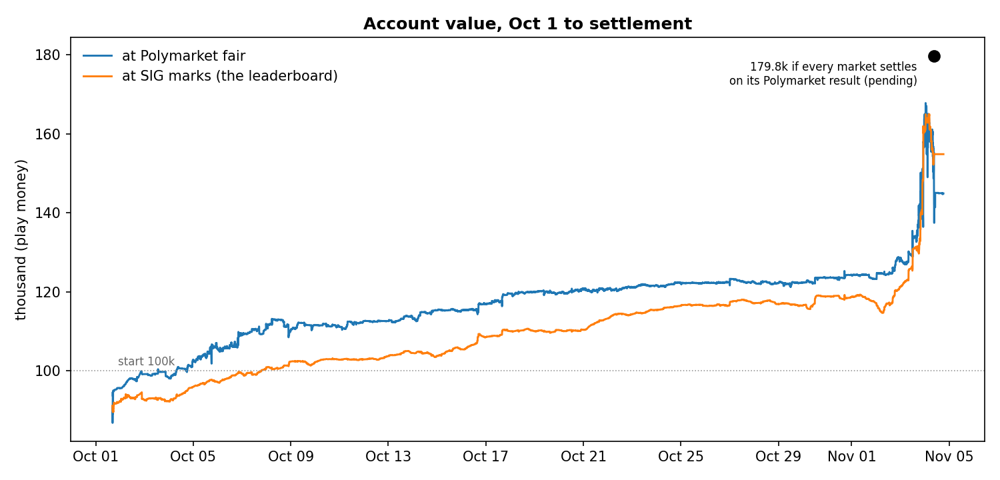
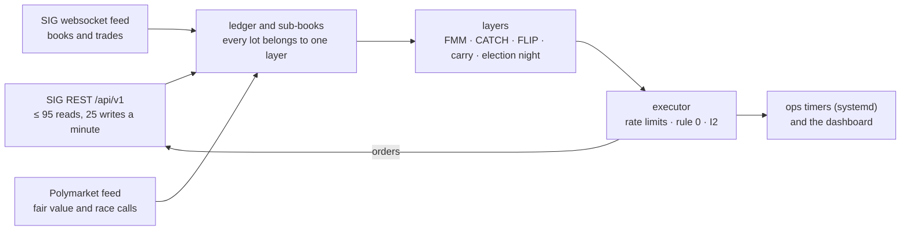
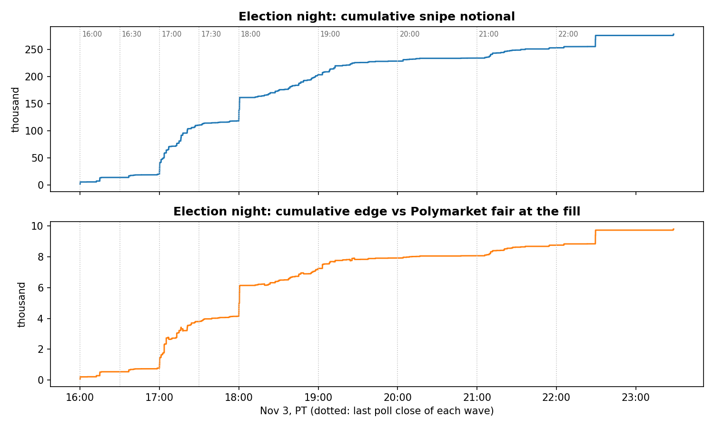
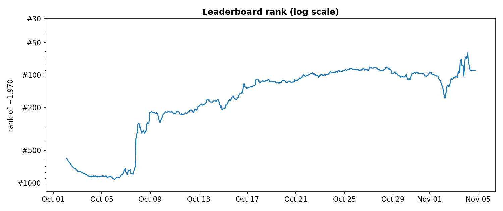

# SIG Predictions Cup 2026: an automated election-market engine

**TL;DR**
- **What it was:** the Susquehanna Predictions Cup, midterm-elections tournament, Oct 1 – Nov 4 2026, starting from 100,000 in play money.
- **Result:** settlement is pending; on Nov 4 evening SIG had settled 0 of its 237 markets.
  - On SIG's leaderboard marks the account ends at **154,876 (+54.9k)**, rank **#90 of 1,969** (best #62).
  - If every market settles on the result Polymarket already shows, it ends at **179,795 (+79.8k)**.
  - Official rank: pending.
- **How:** fully automated, one Python engine on a VPS, **204 releases over the 34-day competition, 421 tests**.

History rebuilt from the 204 timestamped release snapshots built during the competition, one commit each. The date is the deploy time from the deploy log from Oct 8, the snapshot's folder time before that.



## Architecture



- Polymarket is the fair-value reference. SIG's own books are thin and often far from it.
- **Rule 0:** a lot is never sold below its average + 0.5c.
- **I2:** on each book, reducing orders (resting, in flight and new, from every layer) never exceed the position. A property test checks it over 500 seeds before every release.
- One file per stage: `a_config.py` (settings) → `b_sig.py` (SIG client) → `c_polymarket.py` → `d_ledger.py` → `e_bots.py` → `f_engine.py` (the loop) → `j_executor.py`, plus `i_realtime.py` (websocket), `l_intel.py` (tape and sweep detection), `n_election.py` (the night) and the dashboards (`g_`, `m_`, `q_`, `r_`).

## Strategies and results

**FMM, favourite market maker**
- Resting bids on favourite-side books at the touch and 1–3c under it. Inventory is offered back at the best ask at once, to recycle cash. Also NO+NO two-book locks.
- **18,400 fills, 3,912 round trips, realized +5.5k.**
- Its last relaunch (Nov 2) made −7 and tied up cash the night needed.

**CATCH: deep bids anchored on SIG's book and Polymarket fair, sold back on the snap-back**
- Four levels at min(SIG bid − 4/8/15c, fair − 10/15/25c) and fair − 40c, on sides with fair 0.25–0.995.
- Exits at max(fill + 3c, min(pre-sweep mid, fair − 1c)), stepping down to SIG's bid, never below fill + 0.5c.
- **Realized +7.9k in about 25 hours of running.** One sweep, NH Governor R on Nov 3, filled 22,306 shares at +6.1k vs fair.

**FLIP, fill-then-flip**
- On books with a SIG spread ≥ 2c, one bid first in the queue at the best bid + 0.5c (≤ fair − 3c). When it fills, an ask goes up at once at max(fill + 1c, best ask − 0.5c).
- **427 round trips (147k shares), realized +0.9k**, 24 minutes from fill to flip on average. Profitable, but a small edge.

**Carry and convergence**
- Favourites held to settlement as a carry book: bids at EV/$ ≥ 11%, sales when EV/$ ≤ 6.5%, never below the lot average + 0.5c.
- From Oct 30 the convergence sales funded the election reserve.
- **Going into the night: 18 lots, 6.8k at cost, EV +1.0k (15% per dollar).**

**The election-night machine**
- **Call detector,** on the Polymarket side bid after the state's last poll close:
  - rule A: ≥ 0.95 held for 20 s;
  - rule B: ≥ 0.98 once (a "strict" call);
  - guards: PM spread ≤ 3c, and the race's other books ≤ 0.04.
- **Sniper:** walks SIG's book up to min(0.97, PM bid − 3c), or PM bid − 1.5c on a strict call. Limits: ≤ 15k shares a race, ≤ 20k a state, ≤ the wave's share of cash. It runs on its own thread with 5 writes a minute reserved.
- **Reversal guard:** a PM bid back under 0.90 within 10 minutes of a call stops the race. Its lots are held, never dumped.
- **Recycling:** strict-called winners are sold at ≥ 0.97 to fund later waves.
- **Poll-close pulls:** entry layers pull at the first close − 600 s. The rehearsal pass mark was ≥ 400 s; measured 419–422 s.
- **Three full rehearsals** in shadow mode, with synthetic Polymarket paths injected into the live feed. They went 19/2, 17/3 and 21/0 (pass/fail).
- **On the night:**
  - calls on 229 books in 115 of 116 races;
  - **636 snipe fills, 295,921 shares, 278k at an average of 0.940, +9.8k vs Polymarket fair at the fill**;
  - call to order handed over: 297 ms at p50, 608 ms at p95.



## Post-mortem

**1. An election cash reserve starved the dump catchers for a week**
- **Symptom:** the dump, fat-finger, ladder and wall layers all showed `full` and rested nothing. From Oct 26 to Nov 2 the tape showed 126 sweeps worth 1.92M of edge vs fair, 1.56M of it after the reserve started. We caught about 0.6k of it, and rank slid from #95 to #120.
- **Cause:** from Oct 28, a reserve ramping from 20k to 60k was held back for election night. Every entry layer saw free cash under 2k. The catchers had in fact been dry since Oct 17, when the market maker took first claim on free cash. Nothing alerted on a layer marked `full` that rested 0 orders.
- **Fix:** CATCH v2 on Nov 2 was exempted from the reserve and anchored on SIG's book as well as Polymarket. It made +7.9k in about a day.
- **Next time:** size a reserve with its opportunity cost, not only its funding cost (the study counted only the sales needed to raise it). And alert when a layer that's switched on has rested nothing for an hour.

**2. Board marks vs settlement value**
- **Symptom:** after the calls the board fell from 165k to 154k, while the settlement value held at about 179k. Rank went from #62 to #90 overnight.
  - Resolved winners sat at thin SIG prices: 15,455 Virginia Senate R NO had a 0.695 bid (10.7k) against 15.5k at settlement.
  - The engine's own fair fell back to SIG's mid wherever Polymarket stopped quoting resolved markets.
- **Cause:** SIG values positions at a lagging `currentPrice`. It isn't the last trade (it matched on 5 of 113 positions), and it drives the leaderboard. I chased board ranks.
- **Fix:** reporting only. The hourly lines valued called sides at 1.00, and the final snapshots showed both values. The final clean-up bought resolved winners at 0.90–0.95.
- **Next time:** pin down the scoring rule in week one (settled outcome vs SIG's VWAP close-out), and run the rank chase on settlement value, not marks.

**3. Per-race sizing too small at the first wave, fixed live**
- **Symptom:** at 16:00, Virginia Senate R NO bought 1,803 shares with 388k shares on the book under the cap. Georgia and Kentucky were the same.
- **Cause:** wave share = multiplier × usable cash ÷ uncalled races in this and later waves. With a multiplier of 2.5 that gave about 1.7k a race. The sims had picked a low multiplier to protect a reversal night and the last wave. The rehearsals logged the same small shares, but no pass/fail criterion looked at them.
- **Fix:** C135, live at 16:14, raised the multiplier to 8 (about 4.6k a race) and topped up the open races.
- **Next time:** add a rehearsal criterion for depth left on the table. And size the first wave from what the book offers, then hold back for later waves, rather than one formula for all.

**4. Sellers recycled winners below the sniper's own price**
- **Symptom:** from 16:00 to 19:15 the generic release layer sold 69,084 shares of freshly called winners at 0.9527, while the sniper was buying the same books at up to 0.97.
  - A new fast recycler went live at 17:15 with asks under the sniper's cap. It was killed after 3 minutes.
  - 19 rule-0 alarms came from sales of snipe lots.
- **Cause:** the older sellers knew nothing about called races: "sell lots with < 3% left at the touch", and the no-edge asks. There was no self-cross check between the sniper and our own asks. The rehearsals never reached the sale branch.
- **Fix:** C138, built and replayed against the night's 260 call events mid-night, live 19:15:
  - the release layer never sells a called side;
  - the recycler asks ≥ max(lot + 2c, 0.97) and above the book's call cap.
- **Next time:** every seller reads the call state. The night design must include every layer, not only the new ones.

**5. The Alaska ranked-choice exclusion was missing from the sniper**
- **Symptom:** the detector called Alaska Senate at a Polymarket bid of 0.95 at 22:04. The sniper bought 14,949 R NO at 0.926.
- **Cause:**
  - Alaska counts by ranked choice for about two weeks, so it can't settle by Nov 4. That means SIG's VWAP close-out risk on top of the race risk.
  - CATCH had Alaska, Maine and Georgia on its skip list. The sniper excluded only manual markets.
  - The rehearsals scripted Alaska as "no call", so the case was never exercised.
- **Fix:** none in code. The election lane was stopped at 01:03, and the shares were sold at 0.80–0.83 (about −1.8k). The call direction still looks right; the loss came from the forced exit.
- **Next time:** one exclusion list read by every layer, and a rehearsal in which an RCV race gets called.

**6. Cash accounting in bursts**
- **Symptom:**
  - In the Oct 21 sim, a filled snipe was counted twice: in the commit ledger and in the falling raw cash. A lost executor answer also released its budget twice, so the first two waves took everything.
  - On the night the error ran the other way. At 22:29 the sniper spent a 20.5k hand sale in 7 seconds on queued snipes. SIG refused writes with "insufficient available funds" while the engine read 20.5k of cash.
  - At 18:00 SIG also turned out to reserve funds for resting orders, which an Oct 2 test had ruled out.
- **Cause:** probably that the sim fix released the fill hold at once while the cash read lagged behind it. And there were two cash models, ours and SIG's.
- **Fix:** C103/C104 fixed the double count before the night. The live over-spend was ended by stopping the lane at 01:03.
- **Next time:** treat SIG's available funds as the only cash authority, use an order record that counts only what was sent and filled, and put manual trades through the same check.

## Results

`results/` holds derived data only:
- `pnl_daily.csv`: the account at SIG marks vs Polymarket fair, per SIG day.
- `rank.csv`: our rank, hourly.
- `night_snipes.csv`: each live call, with race, side, rule, PM bid, shares, average price and edge vs fair.
- `releases.csv`: every release, with its date and summary.



## How to run

```bash
python3 -m venv .venv && .venv/bin/pip install -r requirements.txt
python3 -m unittest discover tests                                      # 421 tests, about a minute, no network
I2_SEEDS=500 python3 -m unittest tests.test_executor.InvariantTests     # the I2 property test (run before every release)
cp .env.example .env    # SIG_API_KEY, SIG_ENGINE_HOST, SIG_DATA, ...
SIG_DATA=/tmp/sig-dry python3 -u f_engine.py      # dry run: reads everything, sends nothing
python3 -u f_engine.py --live                     # trades; refuses on any host but SIG_ENGINE_HOST
```

On a server, `deploy/server/sig-engine.service` runs `start.sh`. That script refuses to start if another engine looks alive, or if the key is missing. `deploy/server/ops/install.sh` installs the ops timers: health lines, alerts, election-night jobs and the settlement watch.

`research/night/` is the election-night simulator, built on the 2024 Polymarket paths, and the rehearsal tooling.

`data/` holds only `pm_map.json`, the SIG ↔ Polymarket market map that the engine and the tests load. Player names and ids in the test fixtures are anonymised.

MIT license.
