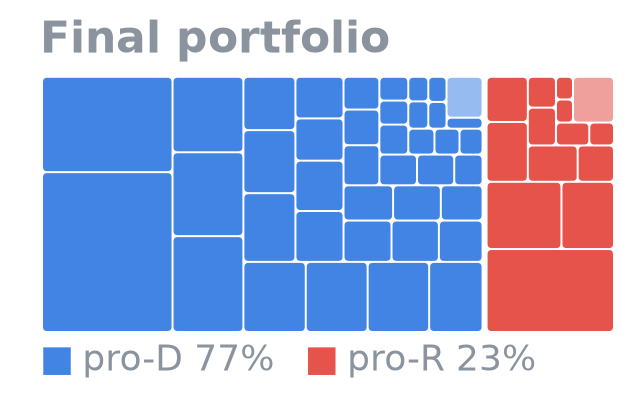
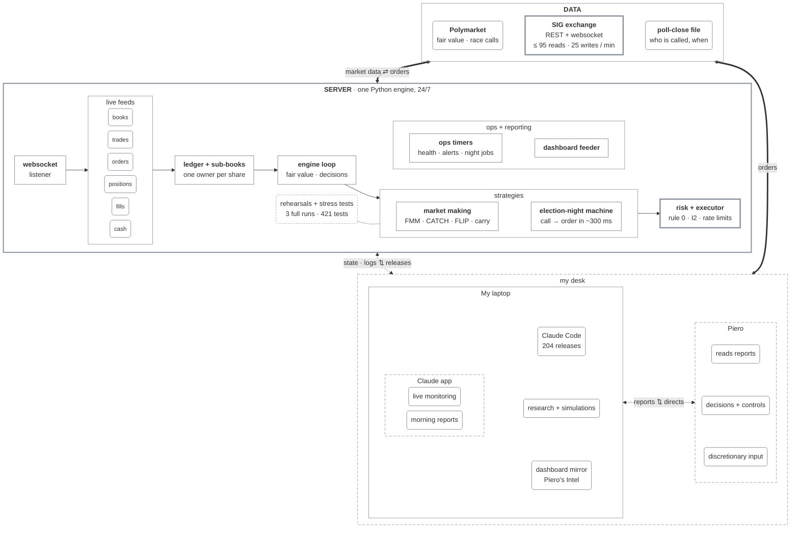
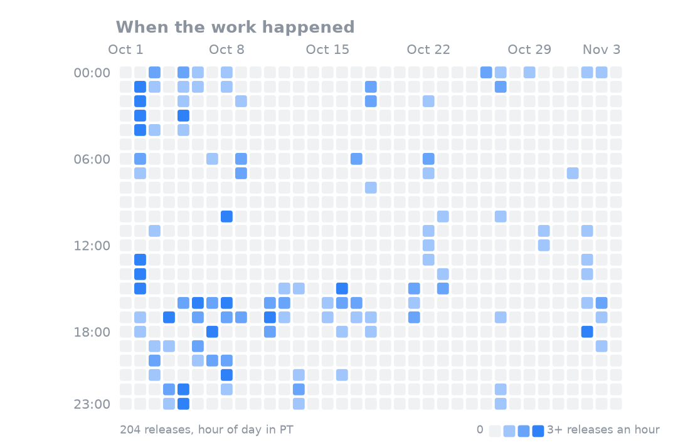

<div align="center">
<h1>Predictions Cup 2026</h1>
</div>

<p align="center"></p>

<p align="center">$\small\color{red}\textsf{Published Monday, Nov 9, 2026 · 15 of our 136 markets were still settling on SIG; they're counted at their called result.}$</p>

## My journey

### Final Results for upbeat-cedar-5206

<div align="center">
<table>
<tr>
<td align="center"><sub>Final rank</sub><br><b>#63</b><br><sub>top 1.2% of 5,141 members · top 3.2% of the 1,969 who traded</sub></td>
<td align="center"><sub>P&amp;L</sub><br><b>+79,874</b><br><sub>board +79,688</sub></td>
<td align="center"><sub>Volume</sub><br><b>3.6M</b></td>
<td align="center"><sub>Trades</sub><br><b>20,544</b></td>
<td align="center"><sub>Win rate</sub><br><b>78%</b><br><sub>of resolved markets</sub></td>
</tr>
</table>
</div>

<sub>Susquehanna (SIG) ran the Cup on its own exchange: five weeks of play-money trading on the 2026 US midterms, 100k each, scored on cash after every market settles.</sub>

I started with a mistake. On day one I traded two contracts by hand and was down 10.3k by the close; by that night the leader was up 603k and I was #591, still down 7.2k. One of the top teams, I learned later, had rested 3,000-share bids at half a cent and asks at 99.5 cents in every market, and caught every careless market order. My engine went live that afternoon and moved to a server on Oct 7, but it took a full week just to get back to 100k, and I fell as low as #928 on the way. From there I built market makers that quoted around Polymarket's prices and climbed into the top 100 by Oct 21. On election night the engine spotted a race call in 115 of 116 races, had an order ready a median 0.3&nbsp;s later, and bought in 95 of them. I finished #63 of 1,969.

<table>
<tr>
<td width="20%" align="center" valign="top"><a href="https://pieropls.github.io/PredictionsCup26/journey.html#account"></a><br><sub>Account from 100k</sub></td>
<td width="20%" align="center" valign="top"><a href="https://pieropls.github.io/PredictionsCup26/journey.html#rank"></a><br><sub>Rank over time</sub></td>
<td width="20%" align="center" valign="top"><a href="https://pieropls.github.io/PredictionsCup26/journey.html#daily"></a><br><sub>Daily P&L</sub></td>
<td width="20%" align="center" valign="top"><a href="https://pieropls.github.io/PredictionsCup26/journey.html#ranking"></a><br><sub>All players · #90 → #63</sub></td>
<td width="20%" align="center" valign="top"><a href="https://pieropls.github.io/PredictionsCup26/journey.html#portfolio"></a><br><sub>Final portfolio, pre‑settlement</sub></td>
</tr>
</table>
<p align="center"><sub>Click a chart to explore it: hover, zoom, full size.</sub></p>

<details><summary><b>Week by week</b></summary>

- **Oct 1** · Day one: two contracts by hand, -10.3k. The engine's first fill comes at 13:16 PT.
- **Oct 6** · The low: #928.
- **Oct 7** · The engine moves to a server and runs 24/7 from then on.
- **Oct 8** · Back above 100k (101.3k), #220 that night.
- **Oct 17** · FMM, the favourite market maker, and the carry book go live.
- **Oct 21** · Into the top 100: #99 at 14:39 PT.
- **Oct 28 → Nov 2** · The election cash reserve (20k rising to 60k) leaves the sweep catchers idle. Low of #165 on Nov 2.
- **Nov 2** · CATCH v2/v3, exempt from the reserve, and FLIP go live. CATCH makes +7.9k realized in about 25 hours.
- **Nov 3** · Election night, live from 14:40 PT: calls in 115 of 116 races, 296k shares at 0.940, +9.8k vs fair.
- **Nov 4, 09:00** · The lock: #90 on SIG's lagging marks (best #62 at 03:48 PT that morning).
- **Nov 5 → 9** · SIG settles in batches, every market so far on Polymarket's result: #90 → #63.

</details>

<!-- Official top 100 ranking: refresh.sh shows this block once data/official_ranking.pdf (or .png) is in the repo
<details><summary><b>Official top 100 ranking</b></summary>

<p align="center"><a href="data/official_ranking.pdf"></a></p>
<p align="center"><sub><a href="data/official_ranking.pdf">Open the PDF</a></sub></p>

</details>
-->

<!-- Certificate: refresh.sh shows this block once data/certificate.pdf (or .png) is in the repo
<details><summary><b>Certificate</b></summary>

<p align="center"><a href="data/certificate.pdf"></a></p>
<p align="center"><sub><a href="data/certificate.pdf">Open the PDF</a></sub></p>

</details>
-->

## Piero's Intel

Piero's Intel is the dashboard I traded from: account, rank, cash, positions and the night's calls, fed by the engine.

**[Open the dashboard →](https://pieropls.github.io/PredictionsCup26/)**



**How it fits together.** The websocket listener and SIG's REST reads keep the books, trades, orders, positions, fills and cash in memory; Polymarket gives the fair price of every contract. The ledger knows which strategy owns every share. Each pass of the engine loop (about every 10 s), the strategies propose orders. Every order then passes the risk check before it reaches SIG: rule 0 (never sell below cost + 0.5c), I2 (never sell more than you hold), the cash floor and SIG's write limit. Around the server, I watched Piero's Intel and Claude's reports and set the controls. Claude turned each change into a written spec, and Claude Code built, tested and shipped it: 204 releases in 34 days.

**Speed**

| What | Measured | Source |
|---|---|---|
| Race call → order ready | 297 ms median, 608 ms p95 (204 orders) | call-lane timer, Nov 3 |
| Order → SIG's acknowledgement | 306 ms median, 558 ms p95 (8,020 batches) | executor journal, Oct 27 → Nov 4 |
| Engine loop | a pass every 10 s median, 15 s p95 | 252,483 loops, Oct 7 → Nov 4 |
| Write budget | SIG allows 30 a minute; the engine used 25, 5 of them held for race calls | SIG's API docs |
| Server | San Francisco region, 24/7 from Oct 7 | run log |

Race calls don't wait for the loop: the election-night sniper runs on its own thread.

<details><summary><b>What each box does</b></summary>

#### Data

| Box | What it does |
|---|---|
| **Polymarket** | The deeper market on the same races; its mid is the fair value for every SIG contract. A race counts as called when our side's bid holds ≥ 0.95 for 20 s, or prints ≥ 0.98 once, after the last poll close. |
| **SIG exchange** | One YES book per contract (NO = 1 − YES); 237 contracts across 117 races. REST for orders, cancels and positions; websocket for books, trades and fills. SIG allows 100 reads and 30 writes a minute; the engine kept to 95 and 25. The board shows SIG marks; the score is cash after every market settles. |
| **Poll-close file** | Every race, its state, and when its last polls close. No call is trusted before that time; resting orders are pulled 10 minutes before each first close. |

#### Server

| Box | What it does |
|---|---|
| **Websocket listener** | Holds the live connection to SIG and turns each message into a state update; Polymarket is polled alongside. |
| **Live feeds** | Books, trades, orders, positions, fills and cash, all in memory. Every strategy reads the same snapshot, and all reads share one budget of 95 a minute. |
| **Ledger + sub-books** | Every share belongs to exactly one strategy, and a strategy can only sell its own lots. The sub-books always sum to the real SIG position. |
| **Engine loop** | Refreshes state, computes fair values, and asks each strategy for orders, about every 10 s. Under systemd on the server from Oct 7 to Nov 4 (on my laptop before that). |
| **Market making** | FMM quotes favourites under fair: 3,912 round trips, +5.5k realized.<br>CATCH v1 → v3 posts deep bids that catch sweeps and sells them on the snap-back: +7.9k realized.<br>FLIP takes first in the queue and flips on the fill: 442 flips, +0.9k realized.<br>Carry holds favourites to settlement. |
| **Election-night machine** | A call detector after each state closes; a sniper under min(0.97, PM − 3c), PM − 1.5c on a strict call from 17:15, up to 15k shares a race; a reversal guard; recycling of called winners to fund later waves. Calls in 115 of 116 races; 296k shares at 0.940, +9.8k vs fair. |
| **Rehearsals + stress tests** | 3 full rehearsals in shadow mode (no orders sent), with synthetic calls injected into the live feed; a night simulator at different cash levels; 421 tests. |
| **Risk + executor** | Rule 0 (never sell below the lot's cost + 0.5c), I2 and the cash floor checked before every order; 25 writes a minute, 5 of them held for race calls; a kill switch per strategy. |
| **Ops timers** | systemd timers for every scheduled step (the 14:40 go-live, poll-close pulls, wind-downs), plus health checks, alerts, the run log and a settlement watch. |
| **Dashboard feeder** | Publishes the account at SIG marks and at fair, the rank, cash and the night's calls. |

#### My laptop

| Box | What it does |
|---|---|
| **Claude app** | Live monitoring: reads the state and logs, flags faults and drift, checks every release. Morning reports: P&L, rank vs #50 and #100, what changed overnight, what to decide. |
| **Claude Code** | Turns each written spec into code and tests, and deploys it: 204 releases in 34 days. |
| **Research + simulations** | Tape studies, the night simulator, parameter sweeps before each change. |
| **Dashboard mirror** | Piero's Intel on my laptop, mirrored from the server every minute. |

#### Piero (me)

| Box | What it does |
|---|---|
| **Reads reports** | Turns the morning and live reports into the day's changes. |
| **Decisions + controls** | Turns strategies on and off, sets caps and timings, stops and re-arms the election machine. |
| **Discretionary input** | Occasional trades and overrides of my own alongside the engine. |

</details>

<details><summary><b>Words used here</b></summary>

- **Fair value:** Polymarket's mid on the same race, used as the price a SIG contract should trade at.
- **SIG marks vs settlement:** the board values positions at SIG's own lagging price; the score is the cash after each market settles at 1 or 0.
- **Called race:** our side's Polymarket bid holds ≥ 0.95 for 20 s, or prints ≥ 0.98 once, after the state's last poll close.
- **Sweep / stink bid:** a large order that walks through several price levels / a resting order far from fair that only fills on such a sweep.
- **Sub-book:** the part of a position one strategy owns; a strategy can only sell its own lots.
- **Rule 0:** never sell below the lot's cost + 0.5c.
- **I2:** a selling order never exceeds the shares held; tested over 500 random seeds before every release.
- **Realized:** profit on closed round trips only; lots still held at the end count in the account, not here.
- **FMM / CATCH / FLIP:** the favourite market maker / deep bids that catch sweeps / one bid first in the queue, flipped on the fill.
- **Call lane:** the sniper's own thread, with 5 writes a minute held for race calls: 297 ms median from call to order.

</details>

## Strategies deployed

Six layers on one ledger: five traded around the clock while switched on, one was built for election night. Each figure is measured inside its layer, and "realized" counts closed trades only, so the figures don't add up to the account's P&L.

<details><summary><b>01 · The Favourite Maker</b> · FMM · <i>quotes favourites under fair</i> · <b>+5.5k</b> · 3,912 round trips</summary>

Bids on favourites (Polymarket fair ≥ 0.75) at the touch and 1–3c under it, never above fair − 2c. Each filled lot goes straight back on offer to recycle the cash.
- **Parameters:** 5k a race at cost; exits at max(fill + 0.5c, fair + the book's 6-hour median gap).
- **Ran:** Oct 17 → Nov 1; relaunched Nov 2 18:26 → Nov 3 00:47.
- **Result:** +5.5k realized over 3,912 round trips (18,400 fills).

</details>

<details><summary><b>02 · The Net</b> · CATCH v1 → v3 · <i>catches sweeps and fat fingers</i> · <b>+7.9k</b> in ~25 h</summary>

Deep bids under SIG's book and Polymarket fair. They fill when someone sweeps the book and are sold back on the snap-back.
- **Parameters (v3):** levels at min(SIG bid − 4/8/15c, fair − 10/15/25c) and fair − 40c; exits at max(fill + 3c, min(pre-sweep mid, fair − 1c)).
- **Ran:** the first dump / fat-finger layers traded Oct 4 → 16, then sat on with no cash (post-mortem 1); v1 → v3 Nov 2 → Nov 3 12:30.
- **Result:** +7.9k realized in about 25 hours (57 exits). One NH Governor R sweep filled 22,306 shares at +6.1k vs fair.

</details>

<details><summary><b>03 · The Flipper</b> · FLIP · <i>first in the queue, flips on the fill</i> · <b>+0.9k</b> · 442 flips</summary>

On books with a SIG spread ≥ 2c, one bid first in the queue at the best bid + 0.5c. On a fill, an ask goes up at once at max(fill + 1c, best ask − 0.5c), and at fill + 0.5c after 30 minutes.
- **Parameters:** the 60 widest books, 1k a book, bid ≤ fair − 3c.
- **Ran:** Nov 2 18:32 → Nov 3 08:00.
- **Result:** +0.9k realized on 442 exit fills (150k shares) against 247 entry fills; a median of about 40 minutes from fill to exit.

</details>

<details><summary><b>04 · The Long Hold</b> · carry + convergence · <i>holds favourites to settlement</i> · <b>EV +13%</b> per dollar at the first poll close</summary>

Favourites held to settlement as a carry book: bids at EV/$ ≥ 11%, sales at EV/$ ≤ 5%, never below the lot's cost + 0.5c. From Oct 29 the convergence sales funded the election reserve.
- **Ran:** Oct 17 → Nov 4.
- **Result:** at the first poll close, 20 lots, 8.3k at cost, EV +1.1k (+13% per dollar). The peak was 33 lots, 25.4k at cost.

</details>

<details><summary><b>05 · The Lock</b> · pair sets, H4, two-book locks · <i>both sides for under 1</i> · <b>+1.4k</b> locked at entry</summary>

Both sides of a two-candidate race bought for under 1 in total.
- **Parameters:** H4 ≤ 0.96 a set; the market maker's locks ≤ 0.99.
- **Ran:** pair sets Oct 1–4, H4 from Oct 11, two-book locks Oct 17 → Oct 29.
- **Result:** the 141 pair sets locked +1.4k at entry; most were unwound early, the majority above cost. The two-book locks held to settlement: +0.2k on 11.7k shares. H4 never found a set.

</details>

<details><summary><b>06 · The Sniper</b> · election-night machine · <i>buys races as they're called</i> · <b>+9.8k</b> vs fair at the fill · 296k shares</summary>

- **Call detector:** our side's Polymarket bid ≥ 0.95 for 20 s, or ≥ 0.98 once, after the state's last poll close. **Calls on 229 books in 115 of 116 races.**
- **Sniper:** walks SIG's book up to min(0.97, PM bid − 3c), ≤ 15k shares a race, on its own thread; from 17:15 (C137) a strict call goes to PM bid − 1.5c. **636 fills in 95 races, 295,921 shares at 0.940, +9.8k vs fair; 297 ms median from call to order (608 ms p95).**
- **Reversal guard:** a PM bid back under 0.90 within 10 minutes stops the race. **Fired 34 times on 21 races.**
- **Recycling:** sells called winners to fund later waves. **31,079 shares at 0.979, +1.0k vs cost.**
- **Poll-close pulls:** entry layers pull from 600 s before the first close; in the rehearsals the last order was gone **at least 419–422 s** before each close.
- **Final sweep, 01:03 → 08:30:** bought resolved winners still offered on SIG. **11,585 shares at 0.929, +0.8k.**

**The night, Nov 3 PT**
- **14:40** Election mode live: 234 books in 116 races armed.
- **16:00** First calls; the sizing formula caps snipes at about 1.7k shares a race.
- **16:14** Release C135 raises the wave multiplier from 2.5 to 8.
- **17:00 / 18:00** The two big waves, about 103k shares each.
- **19:15** C138: sellers stop selling called winners.
- **22:04** Alaska Senate (ranked choice) is called; at 22:29 the cash from a 20.5k sale is spent in 7 seconds.
- **01:03** Election lane stopped; final sweep until 08:30.


</details>

## Working with Claude

I want to be clear about how this was built. I decided what to trade and what to build, and stepped in with my own input when the market moved faster than the rules. Claude Code wrote and tested almost all of the code, from written specs. Claude, in the chat app, was my second brain: it read the logs and the data, wrote the morning reports and the specs, and checked every release. It also got things wrong in a calm, convincing voice: once it reported the market maker refilling a sweep in −0.3 s, before the sweep had even happened. It was a measurement bug; the real median was 4.3 s. So I asked for the number from the data, every time.

**34 days · 204 releases · 88 specs and notes · ~103k-line run log · 421 tests · 3 full rehearsals**

<p align="center"></p>
<p align="center"><sub>46 of the 204 releases went out between midnight and 06:00 PT.</sub></p>

## Takeaways

1. **Test the exchange on day one, then size for it.** My day-one test showed resting orders didn't use up cash, yet I capped deep bids and later held a cash reserve. One top team grew its stink bids from 3,000 to 1M shares in every market ([Teun Schuur's write-up](https://github.com/IHateVolatility/SIG-Prediction-Cup)).
2. **Optimise for the scoring rule, not the marks.** At the Nov 4 lock the board valued my account at 154.9k; at Polymarket's prices it was worth about 179.7k. My rank went from #62 to #90 on the board and came back to #63 as SIG settled.
3. **Size from the book, not one formula.** The first wave bought only 1,803 Virginia Senate R NO; 388k were offered under the cap.
4. **Every seller must read the call state.** An older layer sold 69,084 called winners at 0.9527 (up to 3.3k under settlement value) while the sniper bought at up to 0.97.
5. **Keep one exclusion list.** The sniper bought 14,949 Alaska Senate R NO in a ranked-choice race that couldn't settle in time; selling out cost about 1.8k.
6. **Keep one cash authority.** The sniper spent a 20.5k sale's cash in 7 seconds; SIG then refused writes while the engine still read 20.5k.

<details>
<summary><b>Full post-mortem</b></summary>

**1. An election cash reserve starved the sweep catchers for a week**
- **Symptom:** the dump, fat-finger, ladder and wall layers all showed `full` and rested nothing. From Oct 26 to Nov 2 the tape showed 126 sweeps worth 1.92M of edge vs fair at full sweep size (far more than one account could take), 1.56M of it after the reserve started. About 0.6k was caught, and the rank slid from about #90 to #120 (low #165 on Nov 2).
- **Cause:** from Oct 28, a reserve ramping from 20k to 60k was held back for election night, so every entry layer saw free cash under 2k. The catchers had in fact been dry since Oct 17, when the market maker took first claim on free cash. Nothing alerted on a layer marked `full` that rested 0 orders.
- **Fix:** CATCH v2/v3 on Nov 2 was exempted from the reserve and anchored on SIG's book as well as Polymarket. It made +7.9k realized in about 25 hours.
- **Next time:** size a reserve by its opportunity cost, not only its funding cost. Alert when a layer that's switched on has rested nothing for an hour.

**2. Board marks vs settlement value**
- **Symptom:** after the calls the board fell from 165.0k to 154.9k at the lock while the settlement value held at about 179.7k. The rank went from #62 to #90.
  - Resolved winners sat at thin SIG prices: 15,455 Virginia Senate R NO had a 0.695 bid (10.7k) against 15.5k at settlement.
  - The engine's own fair fell back to SIG's mid wherever Polymarket stopped quoting resolved markets.
- **Cause:** SIG values positions at a lagging `currentPrice` that drives the leaderboard. It isn't the last trade (it matched on 5 of 113 positions). The rank chase used board ranks.
- **Fix:** reporting only. The hourly lines valued called sides at 1.00, and the final snapshots showed both values. The final sweep bought resolved winners at 0.89–0.95. As SIG settled, every market paid Polymarket's result and the rank came back to #63.
- **Next time:** pin down the scoring rule in week one, and run the rank chase on settlement value, not marks.

**3. Per-race sizing too small at the first wave, fixed live**
- **Symptom:** at 16:00, Virginia Senate R NO bought 1,803 shares with 388k shares on the book under the cap. Georgia and Kentucky were the same.
- **Cause:** wave share = multiplier × usable cash ÷ uncalled races in this and later waves. With a multiplier of 2.5 that gave about 1.7k a race. The sims had picked a low multiplier to protect a reversal night and the last wave. The rehearsals logged the same small sizes, but no pass/fail criterion looked at them.
- **Fix:** C135, live at 16:14, raised the multiplier to 8 (about 4.6k a race) and topped up the open races.
- **Next time:** add a rehearsal criterion for depth left on the table. Size the first wave from what the book offers, then hold back for later waves.

**4. Sellers recycled winners below the sniper's own price**
- **Symptom:** from 16:00 to 18:12 the generic release layer sold 69,084 shares of freshly called winners at 0.9527, while the sniper was buying the same books at up to 0.97.
  - A new fast recycler went live at 17:15 with asks under the sniper's cap. It was killed after 3 minutes.
  - 19 rule-0 alarms came from sales of snipe lots.
- **Cause:** the older sellers knew nothing about called races. There was no self-cross check between the sniper and the engine's own asks. The rehearsals never reached the sale branch.
- **Fix:** C138, built and replayed against the night's 260 call events mid-night, live at 19:15:
  - the release layer never sells a called side;
  - the recycler asks ≥ max(lot + 2c, 0.97) and above the book's call cap.
- **Next time:** every seller reads the call state, and the night design covers every layer, not only the new ones.

**5. The Alaska ranked-choice exclusion was missing from the sniper**
- **Symptom:** the detector called Alaska Senate at a Polymarket bid of 0.95 at 22:04. The sniper bought 14,949 R NO at 0.926.
- **Cause:**
  - Alaska counts by ranked choice for about two weeks, so it couldn't settle by Nov 4. That added SIG's close-out risk to the race risk.
  - CATCH had Alaska, Maine and Georgia on its skip list; the sniper had its own, shorter list.
  - The rehearsals scripted Alaska as "no call", so the case was never exercised.
- **Fix:** none in code. The election lane was stopped at 01:03 and the shares were sold at 0.80–0.83 (about −1.8k).
- **Next time:** one exclusion list read by every layer, and a rehearsal in which a ranked-choice race gets called.

**6. Cash accounting in bursts**
- **Symptom:**
  - In the Oct 21 sim, a filled snipe was counted twice: in the commit ledger and in the falling raw cash. A lost executor answer also released its budget twice, so the first two waves took everything.
  - On the night the error ran the other way. At 22:29 the sniper spent the cash from a 20.5k sale in 7 seconds on queued snipes. SIG refused writes with "insufficient available funds" while the engine read 20.5k of cash.
  - At 18:00 SIG refused even exit orders for "insufficient available funds" while it showed 43.8k of cash. I never pinned down why.
- **Cause:** probably that the sim fix released the fill hold at once while the cash read lagged behind it, plus two cash models, the engine's and SIG's.
- **Fix:** C103/C104 fixed the double count before the night. The live over-spend ended when the lane stopped at 01:03.
- **Next time:** treat SIG's available funds as the only cash authority, use an order record that counts only what was sent and filled, and put every order through the same check.

</details>

## Code

```
engine/      a_config → n_election: the pipeline in reading order
dashboard/   Piero's Intel server + site/ (the frozen dashboard, journey.html)
research/    night/ simulator, rehearsals · tests/ 421 tests, fake SIG · tape/
server/      systemd unit, start script, ops timers, deploy, rollback
data/        SIG ↔ Polymarket map + derived CSVs (P&L, rank, snipes, releases)
img/         README images
```

<details><summary><b>How to run</b></summary>

```bash
python3 -m venv .venv && .venv/bin/pip install -r engine/requirements.txt
# 421 tests, about a minute, no network
python3 -m unittest discover research/tests
# the I2 property test over 500 seeds (run before every release)
I2_SEEDS=500 python3 -m unittest research/tests/test_executor.py
# SIG_API_KEY, SIG_ENGINE_HOST, SIG_DATA, ...
cp engine/.env.example .env
# dry run: reads everything, sends nothing
SIG_DATA=/tmp/sig-dry python3 -u engine/f_engine.py
# live: trades, and refuses on any host but SIG_ENGINE_HOST
python3 -u engine/f_engine.py --live
```

- **engine/** is the pipeline in reading order: `a_config` (settings) → `b_sig` (SIG client) → `c_polymarket` → `d_ledger` → `e_bots` → `f_engine` (the loop) → `i_realtime`, `j_executor`, `l_intel`, `n_election`. Each entry point puts `engine/` and `dashboard/` on its path; module names are unchanged.
- **dashboard/** serves Piero's Intel from the engine process; `site/` holds the frozen export and `journey.html`.
- **server/** runs it: `sig-engine.service` starts `start.sh`, which refuses if another engine looks alive or the key is missing; `ops/install.sh` installs the ops timers.
- **research/** holds the election-night simulator and rehearsal tooling (`night/`), the test suite with its fake SIG and night rig (`tests/`), and the tape study (`tape/`).
- **data/** holds `pm_map.json` (the SIG ↔ Polymarket market map) and the derived CSVs. Test fixtures use anonymised player names and ids.

</details>

---

<p align="center">Piero Pelosi · UC Berkeley MFE 2027 · <a href="https://www.linkedin.com/in/piero-pelosi/">LinkedIn</a><br><sub>MIT license.</sub></p>
