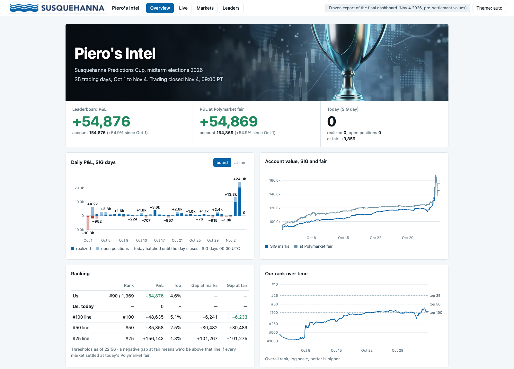
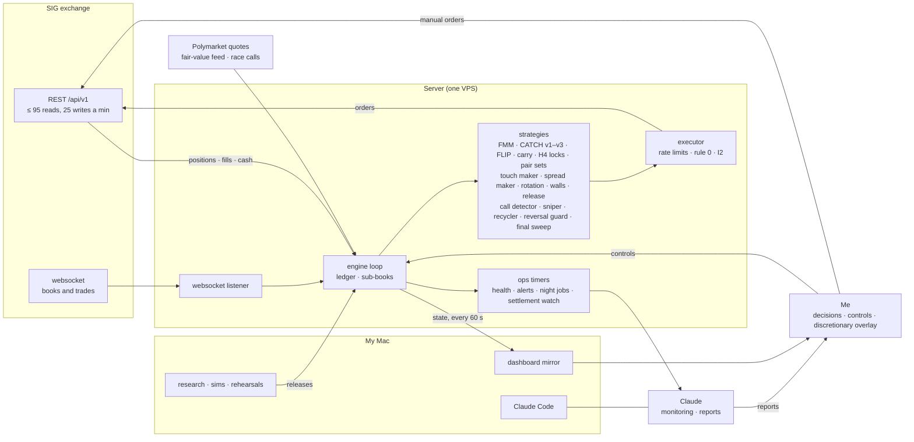

<h1 align="center">Susquehanna Predictions Cup</h1>
<h3 align="center">2026 Midterm Elections Tournament</h3>

<p align="center">
  
  &nbsp;&nbsp;&nbsp;&nbsp;
  
</p>
<p align="center"><sub><i>Personal project by a participant; not affiliated with or endorsed by Susquehanna.</i></sub></p>

## Piero's Intel, live (frozen)

My dashboard, frozen at the final values: **[pieropls.github.io/PredictionsCup26](https://pieropls.github.io/PredictionsCup26/)** (live once public).



## My journey

- **100k → 154.9k on SIG's board: #90 of 1,969 (top 4.6%), best #62.**
- **179.7k (+79.7%) if every market settles on Polymarket's result.** Settlement pending, so the official rank is too.


*Every player's P&L before settlement. The top 1% made +172k or more; the median made 0.*


*From around #900 in week one to the top 100 by Oct 21; best #62 on election night.*


*26 of 31 October days were up at fair (median +0.6k); the last two SIG days made +13.3k and +24.3k.*


*The dot is the value if settlement follows Polymarket's results. The fair line drops at the end because it falls back to SIG's mid once Polymarket stops quoting resolved markets.*

## Final portfolio snapshot


*136 positions at the 09:00 lock; the top ten are worth 84.9k at SIG marks and 97.8k at Polymarket's results.*

## My trading system



- One Python engine; **rule 0:** never sell below the lot average + 0.5c; **I2:** reducing orders never exceed the position.
- 204 releases in 34 days, one commit each in this repo's history.
- 421 tests, including an I2 property test over 500 seeds.
- 3 election-night rehearsals with synthetic Polymarket paths injected into the live feed.

## My strategies

### Systematic core

**FMM, favourite market maker.** Bids on favourites (fair ≥ 0.75) at the touch and 1–3c under, never above fair − 2c; each filled lot is offered straight back.
- Params: 5k a race; exits at max(fill + 0.5c, fair + the book's 6-hour median gap).
- Ran Oct 17 → Nov 1, relaunched Nov 2 18:26 → Nov 3 00:47.
- **+5.5k realized over 3,912 round trips** (18,400 fills).

**CATCH v1 → v3, the sweep and fat-finger catcher.** Deep bids under SIG's book and Polymarket fair, filled when someone sweeps the book, sold back on the snap-back.
- Params (v3): levels at min(SIG bid − 4/8/15c, fair − 10/15/25c) and fair − 40c; exits at max(fill + 3c, min(pre-sweep mid, fair − 1c)).
- Ran: older dump / fat-finger layers Oct 4 → 16; v1–v3 Nov 2 → Nov 3 12:30.
- **+7.9k realized in about 25 hours** (57 exits). One NH Governor R sweep filled 22,306 shares at +6.1k vs fair.

**FLIP, fill-then-flip.** On books with a SIG spread ≥ 2c, one bid first in the queue at the best bid + 0.5c; on a fill, an ask at max(fill + 1c, best ask − 0.5c).
- Params: the 60 widest books, 1k a book, bid ≤ fair − 3c.
- Ran Nov 2 18:32 → Nov 3 08:00.
- **+0.9k realized on 442 flips (150k shares)**, median about 40 minutes from fill to flip.

**Carry and convergence.** Favourites held to settlement: bids at EV/$ ≥ 11%, sales at EV/$ ≤ 5%. From Oct 29 the sales funded the election reserve.
- Ran Oct 17 → Nov 4.
- **At the first poll close: 20 lots, 8.3k at cost, EV +1.1k (13% per dollar)**; the peak was 33 lots, 25.4k at cost.

**H4 and two-book locks.** NO + NO on a two-candidate race for under 1 in total, held to settlement.
- Params: H4 ≤ 0.96; FMM's locks ≤ 0.99.
- Ran: pair sets Oct 1–4, H4 from Oct 11, FMM locks Oct 17 → Oct 29.
- **Pair sets: 141 baskets, +1.4k locked at entry. FMM locks: +0.2k on 11.7k shares.** H4 itself never found a set.

### Election-night machine

- **Call detector:** a Polymarket side bid ≥ 0.95 for 20 s or ≥ 0.98 once, after the state's last poll close. **229 books in 115 of 116 races.**
- **Sniper:** walks SIG's book up to min(0.97, PM bid − 3c), ≤ 15k shares a race, on its own thread. **636 fills, 296k shares at 0.940, +9.8k vs fair.**
- **Reversal guard:** a PM bid back under 0.90 within 10 minutes stops the race. **Fired 34 times on 21 races.**
- **Recycling:** sells called winners to fund later waves. **31,079 shares at 0.979, +1.0k vs cost.**
- **Poll-close pulls:** entry layers pull 600 s before the first close; **419–422 s measured** in the rehearsals.
- **Final sweep, 01:03 → 08:30:** bought resolved winners still offered on SIG. **11,585 shares at 0.929, +0.8k.**

## The Election Night

- **14:40** Election mode live: 234 books in 116 races armed.
- **16:00** First calls; the sizing formula caps snipes at ~1.7k shares a race.
- **16:14** C135 raises the wave multiplier from 2.5 to 8.
- **17:00 / 18:00** The two big waves, ~103k shares each.
- **19:15** C138: sellers stop selling called winners.
- **22:04** Alaska Senate (ranked choice) is called; at 22:29 a 20.5k hand sale is spent in 7 seconds.
- **01:03** Election lane stopped; final sweep until 08:30.


**Calls on 229 books in 115 of 116 races · 296k shares at 0.940 · +9.8k vs fair · 297 ms p50 from call to order.**

## Takeaways

1. **Size a reserve by its opportunity cost.** The election reserve left the catchers idle for a week while the tape showed 1.56M of sweep edge vs fair; they caught about 0.6k.
2. **Optimise for the scoring rule, not the marks.** The board said 154.9k while settlement value was 179.7k, and the rank went from #62 to #90 on SIG's lagging marks.
3. **Size from the book, not one formula.** The first wave bought 1,803 Virginia Senate R NO with 388k shares on the book under the cap.
4. **Every seller must read the call state.** The release layer sold 69,084 shares of called winners at 0.9527 while the sniper bought the same books at up to 0.97.
5. **Keep one exclusion list for every layer.** The sniper bought 14,949 Alaska Senate R NO in a ranked-choice race; the forced exit cost about 1.8k.
6. **Keep one cash authority.** A 20.5k hand sale was spent in 7 seconds on queued snipes; SIG then refused writes while the engine still read 20.5k of cash.

<details>
<summary><b>Full post-mortem</b></summary>

**1. An election cash reserve starved the dump catchers for a week**
- **Symptom:** the dump, fat-finger, ladder and wall layers all showed `full` and rested nothing. From Oct 26 to Nov 2 the tape showed 126 sweeps worth 1.92M of edge vs fair, 1.56M of it after the reserve started. About 0.6k was caught, and the rank slid from #95 to #120.
- **Cause:** from Oct 28, a reserve ramping from 20k to 60k was held back for election night, so every entry layer saw free cash under 2k. The catchers had in fact been dry since Oct 17, when the market maker took first claim on free cash. Nothing alerted on a layer marked `full` that rested 0 orders.
- **Fix:** CATCH v2 on Nov 2 was exempted from the reserve and anchored on SIG's book as well as Polymarket. It made +7.9k in about a day.
- **Next time:** size a reserve with its opportunity cost, not only its funding cost (the study counted only the sales needed to raise it). Alert when a layer that's switched on has rested nothing for an hour.

**2. Board marks vs settlement value**
- **Symptom:** after the calls the board fell from 165k to 154k while the settlement value held at about 179k. The rank went from #62 to #90 overnight.
  - Resolved winners sat at thin SIG prices: 15,455 Virginia Senate R NO had a 0.695 bid (10.7k) against 15.5k at settlement.
  - The engine's own fair fell back to SIG's mid wherever Polymarket stopped quoting resolved markets.
- **Cause:** SIG values positions at a lagging `currentPrice` that drives the leaderboard. It isn't the last trade (it matched on 5 of 113 positions). The rank chase used board ranks.
- **Fix:** reporting only. The hourly lines valued called sides at 1.00, and the final snapshots showed both values. The final sweep bought resolved winners at 0.89–0.95.
- **Next time:** pin down the scoring rule in week one (settled outcome vs SIG's VWAP close-out), and run the rank chase on settlement value, not marks.

**3. Per-race sizing too small at the first wave, fixed live**
- **Symptom:** at 16:00, Virginia Senate R NO bought 1,803 shares with 388k shares on the book under the cap. Georgia and Kentucky were the same.
- **Cause:** wave share = multiplier × usable cash ÷ uncalled races in this and later waves. With a multiplier of 2.5 that gave about 1.7k a race. The sims had picked a low multiplier to protect a reversal night and the last wave. The rehearsals logged the same small shares, but no pass/fail criterion looked at them.
- **Fix:** C135, live at 16:14, raised the multiplier to 8 (about 4.6k a race) and topped up the open races.
- **Next time:** add a rehearsal criterion for depth left on the table. Size the first wave from what the book offers, then hold back for later waves, rather than one formula for all.

**4. Sellers recycled winners below the sniper's own price**
- **Symptom:** from 16:00 to 18:12 the generic release layer sold 69,084 shares of freshly called winners at 0.9527, while the sniper was buying the same books at up to 0.97.
  - A new fast recycler went live at 17:15 with asks under the sniper's cap. It was killed after 3 minutes.
  - 19 rule-0 alarms came from sales of snipe lots.
- **Cause:** the older sellers knew nothing about called races ("sell lots with < 3% left at the touch", and the no-edge asks). There was no self-cross check between the sniper and the engine's own asks. The rehearsals never reached the sale branch.
- **Fix:** C138, built and replayed against the night's 260 call events mid-night, live 19:15:
  - the release layer never sells a called side;
  - the recycler asks ≥ max(lot + 2c, 0.97) and above the book's call cap.
- **Next time:** every seller reads the call state, and the night design covers every layer, not only the new ones.

**5. The Alaska ranked-choice exclusion was missing from the sniper**
- **Symptom:** the detector called Alaska Senate at a Polymarket bid of 0.95 at 22:04. The sniper bought 14,949 R NO at 0.926.
- **Cause:**
  - Alaska counts by ranked choice for about two weeks, so it can't settle by Nov 4. That adds SIG's VWAP close-out risk to the race risk.
  - CATCH had Alaska, Maine and Georgia on its skip list; the sniper excluded only manual markets.
  - The rehearsals scripted Alaska as "no call", so the case was never exercised.
- **Fix:** none in code. The election lane was stopped at 01:03 and the shares were sold at 0.80–0.83 (about −1.8k). The call direction still looks right; the loss came from the forced exit.
- **Next time:** one exclusion list read by every layer, and a rehearsal in which an RCV race gets called.

**6. Cash accounting in bursts**
- **Symptom:**
  - In the Oct 21 sim, a filled snipe was counted twice: in the commit ledger and in the falling raw cash. A lost executor answer also released its budget twice, so the first two waves took everything.
  - On the night the error ran the other way. At 22:29 the sniper spent a 20.5k hand sale in 7 seconds on queued snipes. SIG refused writes with "insufficient available funds" while the engine read 20.5k of cash.
  - At 18:00 SIG also turned out to reserve funds for resting orders, which an Oct 2 test had ruled out.
- **Cause:** probably that the sim fix released the fill hold at once while the cash read lagged behind it, plus two cash models, the engine's and SIG's.
- **Fix:** C103/C104 fixed the double count before the night. The live over-spend ended when the lane stopped at 01:03.
- **Next time:** treat SIG's available funds as the only cash authority, use an order record that counts only what was sent and filled, and put manual trades through the same check.

</details>

## How to run

<details>
<summary><b>Setup, tests, dry run, server</b></summary>

```bash
python3 -m venv .venv && .venv/bin/pip install -r requirements.txt
python3 -m unittest discover tests                                      # 421 tests, about a minute, no network
I2_SEEDS=500 python3 -m unittest tests.test_executor.InvariantTests     # the I2 property test (run before every release)
cp .env.example .env    # SIG_API_KEY, SIG_ENGINE_HOST, SIG_DATA, ...
SIG_DATA=/tmp/sig-dry python3 -u f_engine.py      # dry run: reads everything, sends nothing
python3 -u f_engine.py --live                     # trades; refuses on any host but SIG_ENGINE_HOST
```

- **Pipeline:** one file per stage: `a_config.py` (settings) → `b_sig.py` (SIG client) → `c_polymarket.py` → `d_ledger.py` → `e_bots.py` → `f_engine.py` (the loop) → `j_executor.py`.
  - Alongside them: `i_realtime.py` (websocket), `l_intel.py` (tape and sweep detection), `n_election.py` (the night) and the dashboard (`g_dashboard.py`, `q_dash5.py`, `r_dash5_ui.py`).
- **Server:**
  - `deploy/server/sig-engine.service` runs `start.sh`, which refuses to start if another engine looks alive or the key is missing.
  - `deploy/server/ops/install.sh` installs the ops timers.
- **Election-night simulator:** `research/night/` is the simulator, built on the 2024 Polymarket paths, plus the rehearsal tooling.
- **Results** (`results/`, derived data only):
  - `pnl_daily.csv` (per SIG day) and `rank.csv` (hourly);
  - `night_snipes.csv` (each live call);
  - `releases.csv`.
- **Data and frozen dashboard:**
  - `data/` holds only `pm_map.json`, the SIG ↔ Polymarket market map. Player names and ids in the test fixtures are anonymised.
  - `site/index.html` is the frozen dashboard, also served from the `gh-pages` branch.

</details>

MIT license.
