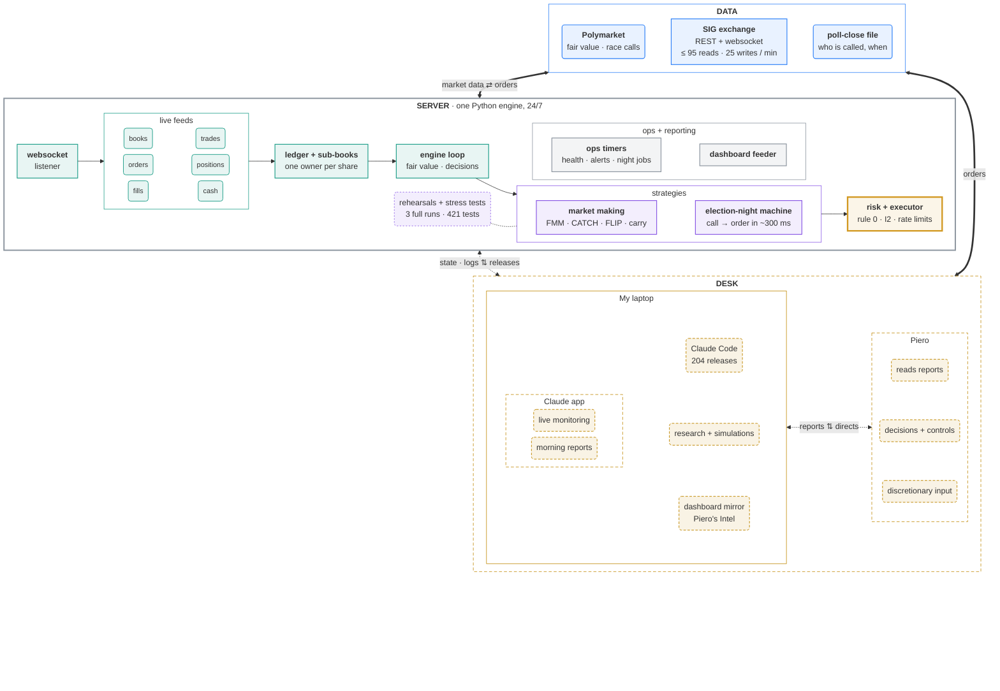
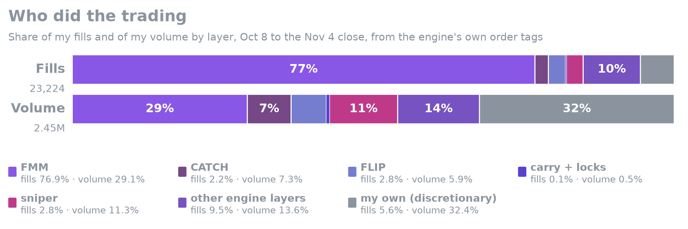

<div align="center">
<h1>Predictions Cup 2026</h1>
</div>

<p align="center"></p>

<p align="center"></p>

## My journey as upbeat-cedar-5206

**I didn't try to predict a single race.** My engine took Polymarket's price as fair value and traded around it on SIG's exchange: making markets, catching sweeps and fat fingers, and buying races the moment they were called, while guarding against adverse selection and players trying to push prices.

<details><summary><b>What is the SIG Predictions Cup?</b></summary>

From Oct 1 to Nov 4, 2026, Susquehanna (SIG) ran the Predictions Cup: a prediction market on the US midterms, on its own exchange. Everyone started with 100,000 SUSQies of play money and was ranked on their balance after every market settled. There were 237 contracts ("Will the Republican Party win the Maine Senate?" and so on), one order book each (NO = 1 − YES), a 0.5c tick, no trading fees, and an API allowing 30 writes and 100 reads a minute. 5,141 people signed up; 1,969 traded.

</details>

<div align="center">
<table>
<tr>
<td align="center"><sub>Final rank</sub><br><b>#63</b><br><sub>top 3.2% of the 1,969 who traded<br>top 1.2% of 5,141 members</sub></td>
<td align="center"><sub>P&amp;L</sub><br><b>+79,874</b><br><sub>board +79.7k</sub></td>
<td align="center"><sub>Volume</sub><br><b>3.6M</b></td>
<td align="center"><sub>Trades</sub><br><b>20,544</b></td>
<td align="center"><sub>Win rate</sub><br><b>85%</b></td>
</tr>
</table>
</div>

I started with a mistake. On day one I traded two contracts by hand and lost 10.3k; that night the leader was up 603k and I was #591. One of the top teams, I learned later, had rested 3,000-share bids at half a cent and asks at 99.5 cents in every market, and caught every careless market order. My engine went live that afternoon and moved to a server on Oct 7, but it took a full week just to get back to 100k, and I fell as low as #928 on the way. From there I built market makers that quoted around Polymarket's prices and climbed into the top 100 by Oct 21. On election night the engine spotted a race call in 115 of 116 races, had an order ready a median 0.3&nbsp;s later, and bought in 95 of them. I finished #63 of 1,969.

<table>
<tr>
<td width="20%" align="center" valign="top"><a href="https://pieropls.github.io/PredictionsCup26/journey.html#account"></a><br><sub>Account from 100k</sub></td>
<td width="20%" align="center" valign="top"><a href="https://pieropls.github.io/PredictionsCup26/journey.html#rank"></a><br><sub>Rank over time</sub></td>
<td width="20%" align="center" valign="top"><a href="https://pieropls.github.io/PredictionsCup26/journey.html#daily"></a><br><sub>Daily P&L</sub></td>
<td width="20%" align="center" valign="top"><a href="https://pieropls.github.io/PredictionsCup26/journey.html#ranking"></a><br><sub>All players · me #63</sub></td>
<td width="20%" align="center" valign="top"><a href="https://pieropls.github.io/PredictionsCup26/journey.html#portfolio"></a><br><sub>Final portfolio, pre‑settlement</sub></td>
</tr>
</table>
<p align="center"><sub>Click a chart to explore it: hover, zoom, full size.</sub></p>

<details><summary><b>Week by week</b></summary>

- **Oct 1** · Day one: two contracts by hand, −10.3k. The engine's first fill comes at 13:16 PT.
- **Oct 6** · The low: #928.
- **Oct 7** · The engine moves to a server and runs 24/7 from then on.
- **Oct 8** · Back above 100k (101.3k), #220 that night.
- **Oct 17** · FMM, the favourite market maker, and the carry book go live.
- **Oct 21** · Into the top 100: #99 at 14:39 PT.
- **Oct 28 → Nov 2** · The election cash reserve (20k rising to 60k) leaves the sweep catchers idle. Low of #165 on Nov 2.
- **Nov 2** · CATCH v2/v3, exempt from the reserve, and FLIP go live. CATCH makes +7.9k realized in about 25 hours.
- **Nov 3** · Election night, live from 14:40 PT: calls in 115 of 116 races, 296k shares at 0.940, +9.8k vs fair.
- **Nov 4, 09:00** · Trading closes. My best rank came that morning: #62 at 03:48 PT.
- **Nov 5 → 9** · SIG settles in batches; #63 as of Nov 9.

</details>

<!-- Official top 100 ranking: refresh.sh shows this block once data/official_ranking.pdf (or .png) is in the repo
<details><summary><b>Official top 100 ranking</b></summary>

<p align="center"><a href="data/official_ranking.pdf"></a></p>
<p align="center"><sub><a href="data/official_ranking.pdf">Open the PDF</a></sub></p>

</details>
-->

<!-- Certificate: refresh.sh shows this block once data/certificate.pdf (or .png) is in the repo
<details><summary><b>Certificate</b></summary>

<p align="center"><a href="data/certificate.pdf"></a></p>
<p align="center"><sub><a href="data/certificate.pdf">Open the PDF</a></sub></p>

</details>
-->

## Piero's Intel

Everything ran on infrastructure I built for the Cup: a Python engine on a server I rented in San Francisco, live 24/7 from Oct 7 to keep the delay to SIG's API short, and Piero's Intel, the dashboard where I watched the account, every position and every strategy in real time.

### The dashboard

Piero's Intel is the screen I traded from. It shows my account at SIG's prices and at Polymarket's fair value, my rank against the top-25, top-50 and top-100 lines, every position with its fair value, and what each strategy did. **[Open Piero's Intel →](https://pieropls.github.io/PredictionsCup26/)** Start on **Overview**; **Engine** shows each strategy, **Markets** every position, **Leaders** the board.

### The pipeline

How the pieces connect: market data comes in from SIG and Polymarket, the server turns it into orders, and my desk watches and steers it.



**How it fits together.** The websocket listener and SIG's REST reads keep the books, trades, orders, positions, fills and cash in memory; Polymarket gives every contract's fair price. The ledger knows which strategy owns every share. Each pass of the engine loop (about every 10 s), the strategies propose orders, and every order passes the risk check before it reaches SIG: rule 0 (never sell below cost + 0.5c), I2 (never sell more than you hold), the cash floor and SIG's write limit. Around the server, I watched Piero's Intel and Claude's reports and set the controls; Claude turned each change into a written spec, and Claude Code built, tested and shipped it: 204 releases in 34 days.

<details><summary><b>Speed</b></summary>

| What | Measured | Source |
|---|---|---|
| Race call → order ready | 297 ms median, 608 ms p95 (204 orders) | call-lane timer, Nov 3 |
| Order → SIG's acknowledgement | 306 ms median, 558 ms p95 (8,020 batches) | executor journal, Oct 27 → Nov 4 |
| Engine loop | a pass every 10 s median, 15 s p95 | 252,483 loops, Oct 7 → Nov 4 |
| Write budget | SIG allows 30 a minute; the engine used 25, including 5 held for race calls | SIG's API docs |
| Server | San Francisco region, 24/7 from Oct 7 | run log |

Race calls don't wait for the loop: the election-night sniper runs on its own thread.

</details>

<details><summary><b>What each box does</b></summary>

Colours: blue for the data, teal for the engine core, purple for the strategies, orange for risk, grey for ops and reporting, amber for my desk.

#### Data

| Box | What it does |
|---|---|
| **Polymarket** | The deeper market on the same races; its mid is the fair value for every SIG contract. A race counts as called when our side's bid holds ≥ 0.95 for 20 s, or touches ≥ 0.98 once, after the last poll close. |
| **SIG exchange** | One YES book per contract (NO = 1 − YES); 237 contracts across 117 races. REST for orders, cancels and positions; websocket for books, trades and fills. SIG allows 100 reads and 30 writes a minute; the engine kept to 95 and 25. The board shows SIG marks; the score is cash after every market settles. |
| **Poll-close file** | Every race, its state, and when its last polls close. No call is trusted before that time; resting orders are pulled 10 minutes before each first close. |

#### Server

| Box | What it does |
|---|---|
| **Websocket listener** | Holds the live connection to SIG and turns each message into a state update; Polymarket is polled alongside. |
| **Live feeds** | Books, trades, orders, positions, fills and cash, all in memory. Every strategy reads the same snapshot, and all reads share one budget of 95 a minute. |
| **Ledger + sub-books** | Every share belongs to exactly one strategy, and a strategy can only sell its own lots. The sub-books always sum to the real SIG position. |
| **Engine loop** | Refreshes state, computes fair values, and asks each strategy for orders, about every 10 s. Under systemd on the server from Oct 7 to Nov 4 (on my laptop before that). |
| **Market making** | FMM quotes favourites under fair; CATCH v1 → v3 posts deep bids that catch sweeps and sells them on the snap-back; FLIP takes first in the queue and flips on the fill; carry holds favourites to settlement. Details in the strategies below. |
| **Election-night machine** | A call detector after each state closes; a sniper under min(0.97, PM − 3c), PM − 1.5c on a strict call from 17:15, up to 15k shares a race; a reversal guard; recycling of called winners to fund later waves. |
| **Rehearsals + stress tests** | 3 full rehearsals in shadow mode (no orders sent), with synthetic calls injected into the live feed; a night simulator at different cash levels; 421 tests. |
| **Risk + executor** | Rule 0 (never sell below the lot's cost + 0.5c), I2 and the cash floor checked before every order; 25 writes a minute, 5 of them held for race calls; a kill switch per strategy. |
| **Ops timers** | systemd timers for every scheduled step (the 14:40 go-live, poll-close pulls, wind-downs), plus health checks, alerts, the run log and a settlement watch. |
| **Dashboard feeder** | Publishes the account at SIG marks and at fair, the rank, cash and the night's calls. |

#### My laptop

| Box | What it does |
|---|---|
| **Claude app** | Live monitoring: reads the state and logs, flags faults and drift, checks every release. Morning reports: P&L, rank vs #50 and #100, what changed overnight, what to decide. |
| **Claude Code** | Turns each written spec into code and tests, and deploys it: 204 releases in 34 days. |
| **Research + simulations** | Tape studies, the night simulator, parameter sweeps before each change. |
| **Dashboard mirror** | Piero's Intel on my laptop, mirrored from the server every minute. |

#### Piero (me)

| Box | What it does |
|---|---|
| **Reads reports** | Turns the morning and live reports into the day's changes. |
| **Decisions + controls** | Turns strategies on and off, sets caps and timings, stops and re-arms the election machine. |
| **Discretionary input** | Occasional trades and overrides of my own alongside the engine. |

</details>

## Strategies deployed

I never forecast a race. Each layer was built for a behaviour I expected from 1,969 players trading play money: thin books, fat fingers and sweeps, players pushing prices to bait others, and a SIG book that lags Polymarket when a race is called. Every quote is anchored to Polymarket's fair value, never to SIG's book alone, so a pushed price can't drag the engine with it.

<p align="center"></p>

<details><summary>🟪 <b>01 · The Favourite Maker</b> · FMM · quotes favourites just under fair · 3,912 round trips</summary>

- **Why:** favourites rarely flip, and a bid stays only while the touch is at least 2c under Polymarket's fair, re-checked every loop, which limits adverse selection.
- **How:** bids at the touch and 1–3c under it on favourites (fair ≥ 0.75), 5k a race at cost; each fill goes straight back on offer at max(fill + 0.5c, fair + the book's 6-hour median gap).
- **When:** Oct 17 → Nov 1, and again Nov 2 18:26 → Nov 3 00:47.
- **Result:** +5.5k realized in this layer over 3,912 round trips (18,400 fills).

</details>

<details><summary>🟪 <b>02 · The Net</b> · CATCH v1 → v3 · deep bids that catch sweeps and fat fingers · 57 exits</summary>

- **Why:** players with play money send size-only orders into thin books; a market order walks the book and leaves the price far below fair for a moment.
- **How (v3):** bids at min(SIG bid − 4/8/15c, fair − 10/15/25c) and at fair − 40c; each fill goes back on offer at max(fill + 3c, min(the pre-sweep mid, fair − 1c)).
- **When:** the first dump and fat-finger layers Oct 4 → 16, then without free cash (post-mortem 1); v1 → v3 Nov 2 → Nov 3 12:30.
- **Result:** +7.9k realized in this layer in about 25 hours (57 exits). One NH Governor R sweep filled 22,306 shares at +6.1k vs fair.

</details>

<details><summary>🟪 <b>03 · The Flipper</b> · FLIP · first in the queue, flips on the fill · 442 flips</summary>

- **Why:** thin SIG books often sat 2c or more wide, so one bid at the front of the queue earns the spread without a view on the race.
- **How:** on the 60 widest books (spread ≥ 2c), one bid at the best bid + 0.5c, never above fair − 3c, 1k a book; on a fill an ask goes up at once at max(fill + 1c, best ask − 0.5c), and at fill + 0.5c after 30 minutes.
- **When:** Nov 2 18:32 → Nov 3 08:00.
- **Result:** +0.9k realized in this layer on 442 exit fills (150k shares) against 247 entry fills; a median of about 40 minutes from fill to exit.

</details>

<details><summary>🟪 <b>04 · The Long Hold</b> · carry · holds favourites to settlement · 33 lots at the peak</summary>

- **Why:** SIG often priced a favourite a few cents under Polymarket; held to settlement, that gap pays without having to sell to anyone.
- **How:** bids where the expected value per dollar against Polymarket's fair is ≥ 11%, sales at ≤ 5%, never below the lot's cost + 0.5c. From Oct 29 the convergence sales funded the election reserve.
- **When:** Oct 17 → Nov 4.
- **Result:** at the first poll close, 20 lots, 8.3k at cost, expected value +1.1k (+13% per dollar). The peak was 33 lots, 25.4k at cost.

</details>

<details><summary>🟪 <b>05 · The Lock</b> · pair sets, H4, two-book locks · both sides of a race for under 1 · 141 pair sets</summary>

- **Why:** players priced each party's book on its own, so a race's two books sometimes added up to less than 1; buying both locks in the gap whatever the result.
- **How:** pair sets and H4 at ≤ 0.96 a set; the market maker's two-book locks at ≤ 0.99.
- **When:** pair sets Oct 1–4, H4 from Oct 11, two-book locks Oct 17 → Oct 29.
- **Result:** the 141 pair sets locked +1.4k at entry; most were unwound early, the majority above cost. The two-book locks held to settlement: +0.2k on 11.7k shares. H4 never found a set.

</details>

<details><summary>🟥 <b>06 · The Sniper</b> · election-night machine · buys races the moment they're called · 115 races called</summary>

- **Why:** after Polymarket calls a race, SIG's book lags: half of the night's fills came 16 minutes or more after the call, with the called side still on offer under 1.
- **How:** a race counts as called when our side's Polymarket bid holds ≥ 0.95 for 20 s, or touches ≥ 0.98 once, after the state's last poll close. The sniper walks SIG's book up to min(0.97, PM bid − 3c), ≤ 15k shares a race, on its own thread; from 17:15 (C137) a strict call goes to PM bid − 1.5c. The reversal guard stops a race whose PM bid falls back under 0.90 within 10 minutes, and entry layers pull from 600 s before each first poll close.
- **When:** Nov 3 14:40 → Nov 4 01:03; a final sweep until 08:30.
- **Result:** calls on 229 books in 115 of 116 races; 636 fills in 95 races, 295,921 shares at 0.940, +9.8k vs Polymarket's fair at the fill; 297 ms median from call to order (608 ms p95). The reversal guard fired 34 times on 21 races; in the rehearsals the last entry order was gone at least 419–422 s before each close. Recycling sold 30,295 shares at 0.979, +1.0k vs cost; the final sweep bought 11,585 shares at 0.929, +0.8k.

**The night, Nov 3 PT**
- **14:40** Election mode live: 234 books in 116 races armed.
- **16:00** First calls; the sizing formula caps snipes at about 1.7k shares a race.
- **16:14** Release C135 raises the wave multiplier from 2.5 to 8.
- **17:00 / 18:00** The two big waves, about 103k shares each.
- **19:15** C138: sellers stop selling called winners.
- **22:04** Alaska Senate (ranked choice) is called; at 22:29 the cash from a 20.5k sale is spent in 7 seconds.
- **01:03** Election lane stopped; final sweep until 08:30.


</details>

## Takeaways

**What worked**
1. **Fair value from Polymarket.** The engine never needed a forecast of its own, and every market SIG has settled so far paid Polymarket's result.
2. **Engineering discipline.** 204 releases, 421 tests and 3 full rehearsals; on the night the sniper had an order ready 0.3&nbsp;s after a call.
3. **Catching sweeps once the cash was free.** CATCH made +7.9k realized in about a day.

**What didn't**
1. **Day one by hand.** Two careless orders cost 10.3k and a week to win back.
2. **Idle catchers.** Capped resting bids, then the election cash reserve, left them idle for a week while the tape showed 1.56M of sweep edge at full size.
3. **Election-night bugs.** First-wave sizing too small, older sellers selling called winners under the sniper's price, the missing Alaska exclusion, and a cash model that disagreed with SIG's.

**What I'd do differently**
1. **Test the exchange's mechanics on day one, and size for them.** Resting orders didn't lock cash.
2. **Optimise for the scoring rule, not the board's marks.** At the close the board valued my account at 154.9k; settlement was worth about 179.7k.
3. **Keep one source of truth.** One exclusion list, one cash authority, and every seller reads the call state.

<details>
<summary><b>Full post-mortem</b></summary>

**1. An election cash reserve starved the sweep catchers for a week**
- **Symptom:** the dump, fat-finger, ladder and wall layers all showed `full` and rested nothing. From Oct 26 to Nov 2 the tape showed 126 sweeps worth 1.92M of edge vs fair at full sweep size (far more than one account could take), 1.56M of it after the reserve started. About 0.6k was caught, and the rank slid from inside the top 100 to about #120 (low #165 on Nov 2).
- **Cause:** from Oct 28, a reserve ramping from 20k to 60k was held back for election night, so every entry layer saw free cash under 2k. The catchers had in fact been dry since Oct 17, when the market maker took first claim on free cash. Nothing alerted on a layer marked `full` that rested 0 orders.
- **Fix:** CATCH v2/v3 on Nov 2 was exempted from the reserve and anchored on SIG's book as well as Polymarket. It made +7.9k realized in about 25 hours.
- **Next time:** size a reserve by its opportunity cost, not only its funding cost. Alert when a layer that's switched on has rested nothing for an hour.

**2. Board marks vs settlement value**
- **Symptom:** after the calls the board fell from 165.0k to 154.9k at the close while the settlement value held at about 179.7k, and the rank slipped from its best, #62, that morning.
  - Resolved winners sat at thin SIG prices: 15,455 Virginia Senate R NO had a 0.695 bid (10.7k) against 15.5k at settlement.
  - The engine's own fair fell back to SIG's mid wherever Polymarket stopped quoting resolved markets.
- **Cause:** SIG values positions at a lagging `currentPrice` that drives the leaderboard. It isn't the last trade (it matched on 5 of 113 positions). The rank chase used board ranks.
- **Fix:** reporting only. The hourly lines valued called sides at 1.00, and the final snapshots showed both values. The final sweep bought resolved winners at 0.89–0.95. As SIG settled, every market paid Polymarket's result and the rank came back to #63.
- **Next time:** pin down the scoring rule in week one, and run the rank chase on settlement value, not marks.

**3. Per-race sizing too small at the first wave, fixed live**
- **Symptom:** at 16:00, Virginia Senate R NO bought 1,803 shares with 388k shares on the book under the cap. Georgia and Kentucky were the same.
- **Cause:** wave share = multiplier × usable cash ÷ uncalled races in this and later waves. With a multiplier of 2.5 that gave about 1.7k a race. The sims had picked a low multiplier to protect a reversal night and the last wave. The rehearsals logged the same small sizes, but no pass/fail criterion looked at them.
- **Fix:** C135, live at 16:14, raised the multiplier to 8 (about 4.6k a race) and topped up the open races.
- **Next time:** add a rehearsal criterion for depth left on the table. Size the first wave from what the book offers, then hold back for later waves.

**4. Sellers recycled winners below the sniper's own price**
- **Symptom:** from 16:00 to 18:12 the generic release layer sold 69,084 shares of freshly called winners at 0.9527 (up to 3.3k under settlement value), while the sniper was buying the same books at up to 0.97.
  - A new fast recycler went live at 17:15 with asks under the sniper's cap. It was killed after 3 minutes.
  - 19 rule-0 alarms came from sales of snipe lots.
- **Cause:** the older sellers knew nothing about called races. There was no self-cross check between the sniper and the engine's own asks. The rehearsals never reached the sale branch.
- **Fix:** C138, built and replayed against the night's 260 call events mid-night, live at 19:15:
  - the release layer never sells a called side;
  - the recycler asks ≥ max(lot + 2c, 0.97) and above the book's call cap.
- **Next time:** every seller reads the call state, and the night design covers every layer, not only the new ones.

**5. The Alaska ranked-choice exclusion was missing from the sniper**
- **Symptom:** the detector called Alaska Senate at a Polymarket bid of 0.95 at 22:04. The sniper bought 14,949 R NO at 0.926.
- **Cause:**
  - Alaska counts by ranked choice for about two weeks, so it couldn't settle by Nov 4. That added SIG's close-out risk to the race risk.
  - CATCH had Alaska, Maine and Georgia on its skip list; the sniper had its own, shorter list.
  - The rehearsals scripted Alaska as "no call", so the case was never exercised.
- **Fix:** none in code. The election lane was stopped at 01:03 and the shares were sold at 0.80–0.83 (about −1.8k).
- **Next time:** one exclusion list read by every layer, and a rehearsal in which a ranked-choice race gets called.

**6. Cash accounting in bursts**
- **Symptom:**
  - In the Oct 21 sim, a filled snipe was counted twice: in the commit ledger and in the falling raw cash. A lost executor answer also released its budget twice, so the first two waves took everything.
  - On the night the error ran the other way. At 22:29 the sniper spent the cash from a 20.5k sale in 7 seconds on queued snipes. SIG refused writes with "insufficient available funds" while the engine read 20.5k of cash.
  - At 18:00 SIG refused even exit orders for "insufficient available funds" while it showed 43.8k of cash. I never pinned down why.
- **Cause:** probably that the sim fix released the fill hold at once while the cash read lagged behind it, plus two cash models, the engine's and SIG's.
- **Fix:** C103/C104 fixed the double count before the night. The live over-spend ended when the lane stopped at 01:03.
- **Next time:** treat SIG's available funds as the only cash authority, use an order record that counts only what was sent and filled, and put every order through the same check.

</details>

## Code

```
├── engine/                  the trading engine, in pipeline order
│   ├── a_config.py          every setting of the pipeline
│   ├── b_sig.py             SIG's REST client and the read / write budget
│   ├── c_polymarket.py      Polymarket fair values (public API)
│   ├── d_ledger.py          orders, fills and sub-books: one owner per share
│   ├── e_bots.py            the decision logic per market and race, no I/O
│   ├── f_engine.py          the loop: state, fair values, strategies, risk
│   ├── i_realtime.py        websocket feeds that wake the loop
│   ├── j_executor.py        every SIG write: I2, rule 0, the write budget
│   ├── l_intel.py           tape and leaderboard studies inside the engine
│   ├── n_election.py        election night: calls, snipes, recycling
│   ├── requirements.txt
│   └── .env.example         the settings it reads from its environment
├── dashboard/               Piero's Intel
│   ├── g_dashboard.py       the web server in the engine (localhost, token)
│   ├── h_status.py          the engine at a glance, in the terminal
│   ├── m_dash4.py           the v4 payload
│   ├── q_dash5.py           the v5 payload behind the four tabs
│   ├── r_dash5_ui.py        the v5 page code and CSS
│   └── site/
│       ├── index.html       the frozen dashboard (GitHub Pages)
│       └── journey.html     the interactive charts behind the README minis
├── research/
│   ├── night/               the night simulator and sizing studies (23 files)
│   ├── tape/
│   │   └── k_tape_study.py  where the money on SIG came from
│   └── tests/               421 tests, a fake SIG, the night rig (19 files)
├── server/
│   ├── sig-engine.service   the systemd unit
│   ├── start.sh             refuses to start if another engine is alive
│   ├── push_release.sh      ships a tested release and restarts the unit
│   ├── rollback.sh          moves the engine back to the laptop
│   ├── perms_check.sh       checks folder permissions after each deploy
│   ├── log.sh               one run-log line, stamped by the server clock
│   ├── tunnel.sh            opens the dashboard over SSH
│   └── ops/
│       ├── ops.py           timed jobs: health, alerts, settlement
│       ├── settle_read.py   read-only SIG reads for the settlement watch
│       ├── install.sh       installs the ops timers
│       ├── night/           the rehearsal plan and its checks (3 files)
│       └── systemd/         the ops service and its timers (22 files)
├── data/
│   ├── night_snipes.csv     every race called on election night
│   ├── pm_map.json          the SIG ↔ Polymarket market map
│   ├── pnl_daily.csv        daily P&L at SIG marks and at fair
│   ├── portfolio_final.csv  the positions at the close
│   ├── rank.csv             my rank, hourly
│   └── releases.csv         every release
└── img/                     README images (10 files)
```

<details><summary><b>Working with Claude</b></summary>

Claude Code wrote all of the code: 204 releases in 34 days, plotted below. I ran the project from the Claude app, my second brain: morning reports, reading the situation, and the written specs, prompts and .md files that told Claude Code what to build. Claude Code was my arms: it ran in VS Code, tested every change and pushed releases to the server. I decided what to build, and when to step in.

<p align="center"></p>
<p align="center"><sub>46 of the 204 releases went out between midnight and 06:00 PT.</sub></p>

</details>

<details><summary><b>How to run</b></summary>

```bash
python3 -m venv .venv && .venv/bin/pip install -r engine/requirements.txt
# 421 tests, about a minute, no network
python3 -m unittest discover research/tests
# the I2 property test over 500 seeds (run before every release)
I2_SEEDS=500 python3 -m unittest research/tests/test_executor.py
# SIG_API_KEY, SIG_ENGINE_HOST, SIG_DATA, ...
cp engine/.env.example .env
# dry run: reads everything, sends nothing
SIG_DATA=/tmp/sig-dry python3 -u engine/f_engine.py
# live: trades, and refuses on any host but SIG_ENGINE_HOST
python3 -u engine/f_engine.py --live
```

- **engine/** is the pipeline in reading order. Each entry point puts `engine/` and `dashboard/` on its path; module names are unchanged.
- **server/** runs it: `sig-engine.service` starts `start.sh`, which refuses if another engine looks alive or the key is missing; `ops/install.sh` installs the ops timers.
- **data/** holds the SIG ↔ Polymarket market map and the derived CSVs. Test fixtures use anonymised player names and ids.

</details>

---

<p align="center">Piero Pelosi · <a href="https://www.linkedin.com/in/piero-pelosi/">LinkedIn</a></p>
